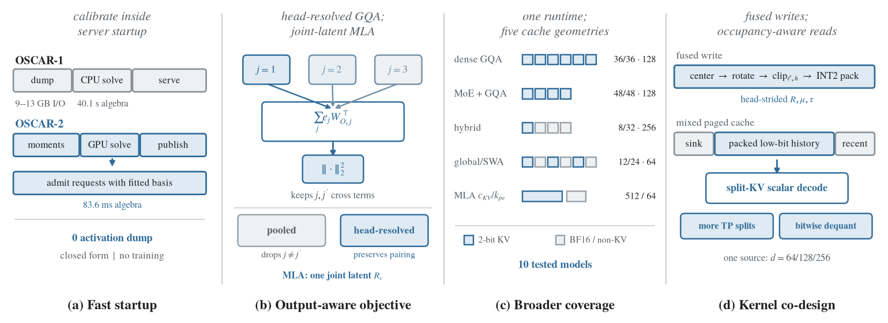

<p align="center">
  
</p>

# OSCAR-2

### Plug-and-Play 2-Bit KV Cache Serving with Head-Resolved GQA and Joint-Latent MLA Calibration

<p align="center">
  <a href="https://arxiv.org/pdf/2605.17757"></a>
  <a href="https://oscar-quantize.github.io/"></a>
  <a href="https://huggingface.co/Zhongzhu/OSCAR-RotationZoo"></a>
  <br/>
  <a href="https://huggingface.co/Zhongzhu/OSCAR-LLAMACPP-Qwen3-32B-INT2-KV"></a>
  <a href="https://huggingface.co/Zhongzhu/OSCAR-LLAMACPP-Gemma-4-12B-it-INT2-KV"></a>
  <a href="https://huggingface.co/Zhongzhu/OSCAR-LLAMACPP-Qwen3-4B-Thinking-2507-INT2-KV"></a>
</p>

Deploying a 2-bit KV cache usually takes an offline calibration pipeline, model-specific transform choices, and a new kernel for every cache geometry. **OSCAR-2 makes attention-aware 2-bit rotation plug-and-play**: the server loads a model, calibrates during startup, and serves heterogeneous cache geometries through one checkpoint format and one kernel family. There is no activation dump, no model-specific calibration script and no per-model kernel.

The bulk of the KV cache is stored in **2 bits**; only a small BF16 sink and recent window stay in full precision. With the per-row scale and zero included this is 2.25–2.5 bits per element: **6–7× more KV tokens than BF16 in the same memory** on most models, 4× for MLA latents. At 128K context and batch 1 the INT2 decode runs at **1.03–1.16× FlashInfer BF16 on H100** for dense models and 0.73–0.94× on B200.

<p align="center">
  
</p>

<p align="center"><sub><b>(a)</b> Closed-form calibration moves into model startup. <b>(b)</b> A head-resolved objective preserves query-head pairing and extends to one joint MLA latent. <b>(c)</b> The Quantizer Family configures only the 2-bit KV state. <b>(d)</b> Head-strided metadata drives fused writes and an occupancy-aware split-KV read path.</sub></p>

This branch is upstream SGLang `main` with OSCAR-2 added under `python/sglang/`. OSCAR-1 (offline dump, fit and evaluate, one rotation per layer) is described in the [OSCAR-1 paper](https://arxiv.org/abs/2605.17757), and its code is on the [`main`](https://github.com/FutureMLS-Lab/OSCAR/tree/main) branch. A llama.cpp port (Metal and CPU) lives on the [`zhongzhu/llamacpp`](https://github.com/FutureMLS-Lab/OSCAR/tree/zhongzhu/llamacpp) branch, and pre-fit rotations are on the [RotationZoo](https://huggingface.co/Zhongzhu/OSCAR-RotationZoo).

## 🔥 Latest News
- **[2026-11-11]** **OSCAR-2**: calibration inside server startup, head-resolved GQA and joint-latent MLA objectives, a matched scalar-INT2 Quantizer Family, and one fused-write / split-KV kernel family for every cache geometry. This README follows the OSCAR-2 paper, which is in preparation.
- **[2026-10-12]** Main results refreshed for **13 models** on the current tree (commit `9105559e8e`, upstream base `67eab57057`): GPQA-Diamond at a 64K budget, KL against BF16 at 128K on PG-19, and 128K decode on B200 and H100. On H100 the INT2 decode is **faster than FlashInfer BF16** on dense models (1.03–1.16× at 128K, batch 1); on B200 it is 0.73–0.94× after raising the default INT2 split cap to 256 and dequantizing with a bf16 bit trick. Most recipes now use per-(layer, KV head) rotations with key centering and a per-head K clip.
- **[2026-10-03]** OSCAR moved onto **upstream SGLang main** (base `67eab57057`, the official nightly of 2026-10-02): the repository root is upstream and OSCAR is the diff. Every INT2 arm runs the model's own attention (DSA for GLM-5.x, MSA for MiniMax-M3, MLA + KDA across two nodes for Kimi-K3). Rotations can be **fit at server start**, and 1-bit / 1.5-bit K via product quantization ships as an opt-in tier.
- **[2026-10-03]** Dense INT2 decode on B200 went from 2–3.9× to 1.2–1.5× of FlashInfer BF16 at 64K / batch 1: a separate INT2 split cap, a fused HP + INT2 stage-1, batched decode rotations, a parallel stage-2 and a parallel metadata build, all default-on and checked bit-for-bit against the two-launch path.
- **[2026-06-26]** OSCAR is PRing into **vLLM** too, bringing INT2 KV cache support to another high-throughput serving stack.
- **[2026-06-07]** OSCAR INT2 KV cache now runs **256K Gemma 4 12B under <code style="color : Red">!!16GB!!</code>** and **Qwen3** on the [`zhongzhu/llamacpp` llama.cpp fork](https://github.com/FutureMLS-Lab/OSCAR/tree/zhongzhu/llamacpp) — **~8× smaller KV at near-f16 quality**, with [pre-built `*-rot-kv.gguf` on Hugging Face](https://huggingface.co/Zhongzhu/OSCAR-LLAMACPP-Gemma-4-12B-it-INT2-KV). RUN GEMMA 4 / QWEN3 with LONG CONTEXT on your LOCAL MAC!
  <details>
  <summary> <b>MacBook M5 Max Gemma 4 12B OSCAR INT2 KV Local Run Video</b></summary>
  
  </details>

<details>
<summary><b>More news</b></summary>

- **[2026-06-05]** OSCAR now runs its INT2 KV cache through a fused mixed-precision Flash-Attention kernel on Apple Metal in the [`zhongzhu/llamacpp` llama.cpp fork](https://github.com/FutureMLS-Lab/OSCAR/tree/zhongzhu/llamacpp), making long-context decode up to ~15× faster (near-BF16) at ~7× less KV memory. Try to RUN QWEN-3-32B with LONG CONTEXT in your LOCAL MAC!
  <details>
  <summary><b>MacBook M5 Max Qwen3-32B OSCAR INT2 KV Local Run Screenshot</b></summary>
  
  </details>
- **[2026-06-04]** OSCAR now supports **Gemma 4 12B** with **SGLang INT2 KV cache** on the [`zhongzhu/gemma4-12b`](https://github.com/FutureMLS-Lab/OSCAR/tree/zhongzhu/gemma4-12b) branch.
- **[2026-05-31]** OSCAR is now runnable on the zhongzhu/llamacpp branch of **llama.cpp**. Feedback and suggestions are very welcome!
- **[2026-05-23]** OSCAR released the Qwen3.5 4B, 35B-A3B and MiniMax-M2.7 229B preview results (branch zhongzhu/hybrid-model at the time; these models now run from this tree).
- **[2026-05-18]** Full release: [paper](https://arxiv.org/pdf/2605.17757), code, [website](https://oscar-quantize.github.io/), and [RotationZoo](https://huggingface.co/Zhongzhu/OSCAR-RotationZoo) are all live — runs out of the box on **SGLang**.

</details>

## 📖 Table of Contents
- [What OSCAR-2 adds](#what-oscar-2-adds)
- [Main results](#main-results)
  - [Previous results](#previous-results)
- [Quick start](#-quick-start)
- [Supported models](#supported-models)
- [Advanced usage](#advanced-usage)
- [Layout](#layout)
- [Troubleshooting](#troubleshooting)
- [Citation](#citation)
- [License & acknowledgements](#license--acknowledgements)

## What OSCAR-2 adds

| | OSCAR-1 | OSCAR-2 |
|:---|:---|:---|
| Calibration | dump Q/K/V, solve offline on the CPU, install a separate artifact | collect moments during a prefill-only startup pass, reduce over TP, eigendecompose, install before the first request |
| Objective | pooled query / score-weighted covariance | head-resolved post-`W_O` metric for GQA; one joint key/value latent for MLA |
| Quantizer | one rotation per layer, global K / V clip ratios | shared or per-KV-head rotations, key centering, per-head K clip, orthogonal or non-orthogonal bases, uniform or Lloyd–Max levels, all in one checkpoint format |
| Models | dense models on `main`, hybrid and Gemma-4 on feature branches | one tree: one fused write kernel driven by head-strided metadata and one split-KV read path for dense, GQA, MoE, sliding-window, hybrid and MLA caches |

**1. Startup-time closed-form calibration.** With the mixed pool on and no rotation file given, the pool starts on identity bases and the server prefills calibration prompts before it takes traffic. The attention layers accumulate per-(layer, KV head) moments, the scheduler reduces them across TP ranks and eigendecomposes them in FP64, and the rotations are installed in place, so captured decode CUDA graphs stay valid. The checkpoint is written atomically; later launches load it and skip collection. The same pass can save the per-head moments, from which every per-head variant below is fit in closed form, without an activation dump or gradient training. Code: `srt/entrypoints/oscar_startup_calibration.py`, `srt/mem_cache/oscar_calibration.py`; usage under [Advanced usage](#advanced-usage).

**2. Head-resolved output awareness.** Under GQA several query heads read one KV head, each with its own attention weights and its own block of `W_O`, and pooling their moments loses that pairing. OSCAR-2 keeps the pairing and the within-group cross-head terms in the value metric `G_h = Σ_{j,j'∈G_h} ρ_{h,jj'} W_{O,j}ᵀ W_{O,j'}`, where ρ is the query heads' co-attention (variant `outaware_hr`). MLA reads one latent as both key and value, so independent key and value rotations are invalid; OSCAR-2 fits one latent transform from the joint metric `M_K/tr M_K + λ·M_V/tr M_V` and keeps the rotary part `k_pe` in BF16 (`rotation/tools/fit_mla_joint_latent.py`).

**3. A matched scalar-INT2 Quantizer Family.** Granularity, key centering, clipping, transform variant and reconstruction levels change one at a time behind one checkpoint format, with the cache rate, page layout and kernels held fixed. In these sweeps per-head fitting pays off only together with key centering and per-head clipping: fitting heads independently exposes a large key-mean direction that consumes the row's dynamic range. Centering subtracts the per-head key mean before the rotation, which shifts every logit of a query by one constant and leaves the softmax unchanged.

**4. Kernel and runtime co-design.** One Triton kernel centers, rotates, clips with the per-head ratio, quantizes and packs each history row. Rotation, mean and clip pointers are head-strided (stride 0 is OSCAR-1's sharing), so family members change metadata rather than launch topology. Decode runs split-KV over the packed history and the BF16 windows and merges their online-softmax statistics. The INT2 history has its own split budget (`SGLANG_INT2_MAX_SPLITS`, default 256), so TP ranks that own few KV heads still fill the GPU, and the inner loop rebuilds a 2-bit code `c` as `bitcast_bf16(c | 0x4300) − 128` instead of converting an integer. The same parameter indirection keeps every geometry compatible with radix caching and CUDA graphs.

## Main results

Measured on this tree with the OSCAR-2 recipes; most rows use per-(layer, KV head) rotations with key centering and a per-head K clip. The OSCAR-2 paper's full matched tables (every model, startup latency, serving) will be added with the paper. Earlier measurements, including the OSCAR-1 paper results, are kept under [Previous results](#previous-results).

### Thirteen models

| Model | Attention (INT2 path) | GPQA-Diamond BF16 → INT2 | KL@128K ↓ | Decode @128K, B200: INT2 / BF16 tok/s | Decode @128K, H100: INT2 / BF16 tok/s | KV tokens vs BF16 |
|:---|:---|:---:|:---:|:---:|:---:|:---:|
| Qwen3-4B-Thinking-2507 | dense GQA | 66.7 → 60.1 | 0.096 | 124.7 / 157.8 (0.79×) | 111.0 / 96.0 (**1.16×**) | 6.4× |
| Qwen3-8B | dense GQA | 59.1 → 55.6 | 0.097 | 110.4 / 134.3 (0.82×) | 91.2 / 79.1 (**1.15×**) | 6.4× |
| Qwen3-32B | dense GQA | 62.6 → 64.1 | 0.087 | 72.9 / 87.3 (0.84×) | 55.5 / 53.2 (**1.04×**) | 6.4× |
| Qwen3-30B-A3B | MoE, dense GQA (4 KV heads) | 62.6 → 56.6 | 0.104 | 189.3 / 237.5 (0.80×) | 174.0 / 168.6 (**1.03×**) | 6.4× |
| Qwen3.5-4B | hybrid GatedDeltaNet + GQA | 76.3 → 76.8 | 0.031 | 232.7 / 276.7 (0.84×) | 193.6 / 185.4 (**1.04×**) | 7.1× |
| Qwen3.5-35B-A3B | hybrid GatedDeltaNet + GQA, MoE | 80.8 → 81.3 | 0.032 | 259.4 / 307.4 (0.84×) | 271.3 / 283.7 (0.96×) | 7.1× |
| Qwen3.8-27B | hybrid GatedDeltaNet + GQA | 88.4 → 86.9 | 0.029 | 125.5 / 139.4 (0.90×) | 79.9 / 79.7 (1.00×) | 7.1× |
| Gemma-4-12B-it | hybrid SWA, two head geometries | 64.1 → 62.6 | 0.175 | 98.9 / 165.1 (0.60×) ¹ | 73.5 / 30.0 ¹ | 5.1× |
| MiniMax-M2.7 | dense GQA, FP8 weights | 83.3 → 83.8 | 0.077 | 104.7 / 111.4 (0.94×) | 131.6 / 119.6 (**1.10×**) | 6.4× |
| MiniMax-M3 | VL-MoE, MSA sparse | 90.9 → 87.4 ² | 0.039 | 95.5 / 120.0 (0.80×) | — ³ | 3.4× |
| GLM-4.7-FP8 | dense GQA, FP8 weights | 80.8 → 77.8 ² | 0.102 | 58.5 / 79.9 (0.73×, TP 4) | 85.2 / 83.9 (**1.02×**, TP 8) | 6.4× |
| GLM-5.3 | MLA + DSA sparse, packed 2-bit latent | 90.4 → 86.9 | 0.040 | 93.3 / 112.9 (0.83×) | — ³ | 3.7× |
| Kimi-K3 | MLA + KDA hybrid, packed 2-bit latent | 91.9 → 90.9 | 0.012 | 36.9 / 47.7 (0.77×) ¹ | — ³ | 4.0× |

- **GPQA-Diamond:** all 198 questions, 64K generation budget, one seed. Identical repeat runs of one configuration spread by about ±2.7 pp, so gaps under ~5 pp are within noise.
- **KL@128K:** KL(BF16 ‖ INT2) in nats per token on PG-19 books (first 131,072 tokens of each, second half scored, every 32nd position), through the serving path with 512-token prefill chunks, so each position reads at most the last 512 tokens in BF16 and the rest of its history from the INT2 tier, as in decode. Lower is better.
- **Decode:** batch 1, a 128K-token prompt and 512 generated tokens, median of three, both arms in the same pod. The BF16 arm is FlashInfer unless noted.
- **KV tokens:** tokens the INT2 pool holds versus the BF16 pool at the same memory fraction, with the BF16 windows and the fp32 per-row scale and zero included (2.5 bits per element at head_dim 128, 2.25 at head_dim 256). MLA rows store a packed 2-bit latent (288 vs 1152 B per token per layer, 4.00×); the MiniMax-M3 and GLM-5.3 pools also hold BF16 sparse-index caches that stay unquantized.
- ¹ BF16 arm: Gemma-4 uses `trtllm_mha` on B200 and `triton` on H100 (no FlashInfer path serves it, so its H100 pair is not like-for-like); Kimi-K3 uses `trtllm_mla` on two nodes (TP 8 × PP 2).
- ² INT2 arm measured on an earlier tree of the same upstream base; the re-run on the current image is pending.
- ³ The model does not fit one 8 × H100 node.
- Recipes (windows, levels, parallelism) are in `rotation/run/<model>.sh`; the Kimi-K3 row used 128 / 512 BF16 windows, where its script defaults to 64 / 256. Most dense and hybrid rows use a per-(layer, KV head) rotation with key centering, uniform INT2 levels and a K clip chosen per head on calibration rows; Gemma-4 and MiniMax-M2.7 use one global K clip, MiniMax-M2.7 and GLM-4.7 head-resolved output-aware values, GLM-4.7 Lloyd-Max levels, and MiniMax-M3 a layer-shared rotation.

### KL against BF16 across context lengths

KL(BF16 ‖ INT2) in nats per token on PG-19 with the protocol of the `KL@128K` column above: for each length L, the first L tokens of each book, the second half scored at every 32nd position, 512-token prefill chunks, B200. Top-1 agreement with BF16 is in parentheses. On the dense Qwen3 models with head_dim 128 (4B, 8B, 30B-A3B) KL is highest at 8K–32K (0.17–0.27) and falls to about 0.10 at 128K; the head_dim-256 hybrids (Qwen3.5, Qwen3.8) stay at 0.02–0.03 at every length.

| Model | 8K | 16K | 32K | 64K | 128K |
|:---|---:|---:|---:|---:|---:|
| Qwen3-4B-Thinking-2507 | 0.2218 (80%) | 0.1977 (80%) | 0.1721 (81%) | 0.1558 (82%) | 0.0956 (86%) |
| Qwen3-8B | 0.1751 (82%) | 0.1948 (80%) | 0.1840 (80%) | 0.1232 (83%) | 0.0969 (85%) |
| Qwen3-32B | 0.0632 (89%) | 0.0775 (87%) | 0.0803 (87%) | 0.0925 (86%) | 0.0871 (86%) |
| Qwen3-30B-A3B | 0.2562 (77%) | 0.2693 (76%) | 0.1955 (78%) | 0.1410 (82%) | 0.1044 (85%) |
| Qwen3.5-4B | 0.0228 (93%) | 0.0254 (91%) | 0.0296 (92%) | 0.0314 (91%) | 0.0305 (92%) |
| Qwen3.5-35B-A3B | 0.0182 (93%) | 0.0223 (93%) | 0.0249 (93%) | 0.0279 (93%) | 0.0323 (92%) |
| Qwen3.8-27B | 0.0177 (94%) | 0.0203 (94%) | 0.0255 (92%) | 0.0297 (91%) | 0.0292 (92%) |
| Gemma-4-12B-it | 0.1480 (85%) | 0.1782 (83%) | 0.1851 (83%) | 0.1843 (82%) | 0.1745 (84%) |
| MiniMax-M2.7 | 0.0651 (89%) | 0.0725 (88%) | 0.0778 (87%) | 0.0818 (86%) | 0.0773 (87%) |
| MiniMax-M3 | 0.0425 (91%) | 0.0456 (91%) | 0.0501 (89%) | 0.0508 (90%) | 0.0391 (90%) |
| GLM-4.7-FP8 | 0.0409 (90%) | 0.0463 (90%) | 0.0593 (89%) | 0.0777 (86%) | 0.1024 (86%) |
| GLM-5.3 | 0.0405 (92%) | 0.0425 (90%) | 0.0435 (91%) | 0.0514 (89%) | 0.0397 (91%) |
| Kimi-K3 | 0.0089 (97%) | 0.0116 (96%) | 0.0135 (96%) | 0.0127 (96%) | 0.0118 (96%) |

<details>
<summary><b>The same curves with BF16 perplexity and the NOVA-KV and OptR reimplementations</b></summary>

NOVA-KV is reimplemented inside this engine: its transform and per-head PQ codebooks (g = 4, K = 256) are fit on the same 128K calibration rows as OSCAR-2; its per-token RMS scale (+0.125 bpe) and its CUDA kernels are not reproduced. OptR is reimplemented as R = R₀·exp(A − Aᵀ), trained for 80 Adam steps with a straight-through estimator through the real write kernel (keys, then values), initialized from the centered basis on the same calibration rows. "Not supported" means the method's published code does not cover the model, so no arm was fit.

| Model | Arm | 8K | 16K | 32K | 64K | 128K |
|---|---|---:|---:|---:|---:|---:|
| **Qwen3-4B-Thinking-2507** | BF16 PPL (PG-19, same positions) | 16.81 | 16.53 | 17.28 | 18.96 | 11.36 |
| | OSCAR-2 (scalar INT2, per head) | **0.2218 (80%)** | **0.1977 (80%)** | **0.1721 (81%)** | **0.1558 (82%)** | **0.0956 (86%)** |
| | NOVA-KV (VQ) | 0.0364 (92%) | 0.0381 (92%) | 0.0424 (91%) | 0.0532 (90%) | 0.0527 (89%) |
| | OptR | 0.7481 (64%) | 0.5301 (69%) | 0.3542 (75%) | 0.2126 (80%) | 0.1089 (85%) |
| **Qwen3-8B** | BF16 PPL (PG-19, same positions) | 14.14 | 13.93 | 14.63 | 17.37 | 10.52 |
| | OSCAR-2 (scalar INT2, per head) | **0.1751 (82%)** | **0.1948 (80%)** | **0.1840 (80%)** | **0.1232 (83%)** | **0.0969 (85%)** |
| | NOVA-KV (VQ) | 0.0396 (92%) | 0.0436 (90%) | 0.0517 (89%) | 0.0562 (88%) | 0.0551 (89%) |
| | OptR | 0.1865 (81%) | 0.1890 (80%) | 0.2112 (78%) | 0.1355 (82%) | 0.0903 (86%) |
| **Qwen3-32B** | BF16 PPL (PG-19, same positions) | 10.27 | 10.38 | 11.08 | 13.12 | 8.14 |
| | OSCAR-2 (scalar INT2, per head) | **0.0632 (89%)** | **0.0775 (87%)** | **0.0803 (87%)** | **0.0925 (86%)** | **0.0871 (86%)** |
| | NOVA-KV (VQ) | 0.0367 (92%) | 0.0440 (90%) | 0.0456 (89%) | 0.0530 (89%) | 0.0426 (90%) |
| | OptR | 0.0936 (85%) | 0.1239 (83%) | 0.1221 (84%) | 0.1227 (83%) | 0.0863 (86%) |
| **Qwen3-30B-A3B** | BF16 PPL (PG-19, same positions) | 11.88 | 12.18 | 14.16 | 16.37 | 9.95 |
| | OSCAR-2 (scalar INT2, per head) | **0.2562 (77%)** | **0.2693 (76%)** | **0.1955 (78%)** | **0.1410 (82%)** | **0.1044 (85%)** |
| | NOVA-KV (VQ) | 0.0335 (92%) | 0.0514 (89%) | 0.0527 (89%) | 0.0567 (88%) | 0.0474 (89%) |
| | OptR | 0.2743 (77%) | 0.2854 (75%) | 0.2231 (77%) | 0.1810 (80%) | 0.1276 (83%) |
| **Qwen3.5-4B** | BF16 PPL (PG-19, same positions) | 10.37 | 11.21 | 11.52 | 13.70 | 8.99 |
| | OSCAR-2 (scalar INT2, per head) | **0.0228 (93%)** | **0.0254 (91%)** | **0.0296 (92%)** | **0.0314 (91%)** | **0.0305 (92%)** |
| | NOVA-KV (VQ) | 0.0358 (92%) | 0.0421 (90%) | 0.0501 (89%) | 0.0595 (88%) | 0.0549 (88%) |
| | OptR | 0.0221 (93%) | 0.0248 (91%) | 0.0295 (92%) | 0.0323 (91%) | 0.0304 (92%) |
| **Qwen3.5-35B-A3B** | BF16 PPL (PG-19, same positions) | 7.59 | 8.35 | 8.86 | 10.33 | 7.37 |
| | OSCAR-2 (scalar INT2, per head) | **0.0182 (93%)** | **0.0223 (93%)** | **0.0249 (93%)** | **0.0279 (93%)** | **0.0323 (92%)** |
| | NOVA-KV (VQ) | 0.0313 (92%) | 0.0399 (91%) | 0.0492 (90%) | 0.0571 (89%) | 0.0658 (88%) |
| | OptR | 0.0178 (94%) | 0.0225 (93%) | 0.0253 (93%) | 0.0281 (93%) | 0.0310 (92%) |
| **Qwen3.8-27B** | BF16 PPL (PG-19, same positions) | 8.02 | 8.64 | 9.25 | 10.49 | 7.55 |
| | OSCAR-2 (scalar INT2, per head) | **0.0177 (94%)** | **0.0203 (94%)** | **0.0255 (92%)** | **0.0297 (91%)** | **0.0292 (92%)** |
| | NOVA-KV (VQ) | 0.0295 (92%) | 0.0385 (91%) | 0.0465 (90%) | 0.0572 (89%) | 0.0550 (89%) |
| | OptR | 0.0176 (94%) | 0.0220 (93%) | 0.0268 (92%) | 0.0303 (92%) | 0.0293 (92%) |
| **Gemma-4-12B-it** | BF16 PPL (PG-19, same positions) | 19.22 | 20.78 | 24.23 | 29.79 | 14.88 |
| | OSCAR-2 (scalar INT2, per head) | **0.1480 (85%)** | **0.1782 (83%)** | **0.1851 (83%)** | **0.1843 (82%)** | **0.1745 (84%)** |
| | NOVA-KV / OptR | Not supported | | | | |
| **MiniMax-M2.7** | BF16 PPL (PG-19, same positions) | 9.29 | 8.92 | 11.54 | 13.50 | 9.35 |
| | OSCAR-2 (scalar INT2, per head) | **0.0651 (89%)** | **0.0725 (88%)** | **0.0778 (87%)** | **0.0818 (86%)** | **0.0773 (87%)** |
| | NOVA-KV (VQ) | 0.1071 (86%) | 0.1161 (85%) | 0.1237 (84%) | 0.1299 (83%) | 0.1124 (85%) |
| | OptR | 0.0598 (89%) | 0.0744 (88%) | 0.0743 (88%) | 0.0784 (86%) | 0.0721 (88%) |
| **MiniMax-M3** | BF16 PPL (PG-19, same positions) | 7.01 | 6.86 | 8.49 | 10.41 | 7.59 |
| | OSCAR-2 (scalar INT2, layer-shared) | **0.0425 (91%)** | **0.0456 (91%)** | **0.0501 (89%)** | **0.0508 (90%)** | **0.0391 (90%)** |
| | NOVA-KV / OptR | Not supported | | | | |
| **GLM-4.7-FP8** | BF16 PPL (PG-19, same positions) | 6.82 | 7.20 | 7.74 | 9.21 | 6.51 |
| | OSCAR-2 (scalar INT2, per head) | **0.0409 (90%)** | **0.0463 (90%)** | **0.0593 (89%)** | **0.0777 (86%)** | **0.1024 (86%)** |
| | NOVA-KV / OptR | Not supported | | | | |
| **GLM-5.3** | BF16 PPL (PG-19, same positions) | 6.04 | 6.66 | 7.16 | 8.10 | 6.26 |
| | OSCAR-2 (packed 2-bit latent) | **0.0405 (92%)** | **0.0425 (90%)** | **0.0435 (91%)** | **0.0514 (89%)** | **0.0397 (91%)** |
| | NOVA-KV / OptR | Not supported | | | | |
| **Kimi-K3** | BF16 PPL (PG-19, same positions) | 3.47 | 4.01 | 3.91 | 4.04 | 2.51 |
| | OSCAR-2 (packed 2-bit latent) | **0.0089 (97%)** | **0.0116 (96%)** | **0.0135 (96%)** | **0.0127 (96%)** | **0.0118 (96%)** |
| | NOVA-KV / OptR | Not supported | | | | |

</details>

### Qwen3-8B in depth: reasoning, long context and tool use

BF16 against the OSCAR-2 recipe (2.5 bits per element), mean ± std over three runs. GPQA-Diamond uses a 64K generation budget with YaRN ×4, the other generation benchmarks 32K. RULER is the official NVIDIA suite (13 tasks, 100 samples each, greedy, no-think template, three data seeds). BFCL is the official v4 overall without the web-search category (it needs a SerpAPI key). Tool-call KL is KL(BF16 ‖ INT2) on the `<tool_call>` tokens of 400 real BFCL multi-turn tool calls replayed from BF16 trajectories (median context 8.3K tokens, 512-token prefill chunks, H100); the share of calls whose whole argmax matches BF16 is in parentheses.

| Benchmark | BF16 | OSCAR-2 |
|:---|:---:|:---:|
| GPQA-Diamond | 55.39 ± 1.62 | 53.87 ± 2.33 |
| AIME 2025 | 65.56 ± 5.09 | 57.78 ± 6.94 |
| MATH-500 | 92.33 ± 0.23 | 92.00 ± 0.87 |
| HumanEval | 88.21 ± 1.53 | 88.01 ± 1.96 |
| LiveCodeBench v6 | 50.13 ± 0.44 | 49.36 ± 1.59 |
| RULER 64K | 79.73 ± 0.91 | 64.51 ± 0.69 |
| RULER 128K | 73.22 ± 0.06 | 56.31 ± 0.42 |
| BFCL v4 (without web search) | 51.35 ± 0.97 | 47.73 ± 1.38 |
| BFCL multi-turn | 41.21 ± 1.06 | 31.71 ± 0.26 |
| KL@128K, PG-19 | 0 (reference) | 0.0969 |
| Tool-call KL | 0 (reference) | 0.0253 (84.0%) |

GPQA, MATH-500, HumanEval and LiveCodeBench stay within run-to-run noise of BF16; AIME 2025 is 7.8 points lower with a spread of 5–7 points per arm. Long-context retrieval (RULER) and multi-turn tool use are where 2-bit keys still cost accuracy. With Qwen3's recommended sampling (temperature 0.6, top-p 0.95, top-k 20; H100) BFCL multi-turn reads 35.88 ± 0.57 against BF16's 41.62 ± 1.76, and the share of decode steps stuck in a repetition loop drops from 2.91% to 0.35%.

### Qwen3-8B against other KV-cache methods

All arms except TurboQuant (vLLM) run in this engine with the protocols above, and the INT2 arms share the recipe's windows (128 BF16 sink, 512 BF16 recent). KL is on PG-19 (B200 for the OSCAR-2 recipe and NOVA-KV, H100 for the others; the recipe reads 0.0969 on B200 and 0.0974 on H100 at 128K), RULER on B200 with three data seeds, and BFCL multi-turn on H100 over three runs (BF16: one run).

| Method | Bits / element | KL@8K | KL@32K | KL@128K | Tool-call KL | RULER 64K / 128K | BFCL multi-turn |
|:---|:---:|---:|---:|---:|:---:|:---:|:---:|
| BF16 | 16 | 0 | 0 | 0 | 0 | 79.73 / 73.22 | 40.88 |
| SGLang FP8 (e4m3) KV | 8 | ≤ 0.022 | ≤ 0.022 | 0.0243 | 0.0018 (95.0%) | — | 41.25 ± 1.27 |
| **OSCAR-2** (per head + centering + per-head K clip) | 2.5 | 0.1751 | 0.1840 | 0.0969 | 0.0253 (84.0%) | 64.51 / 56.31 | 30.33 ± 0.85 |
| **OSCAR-2**, 32K calibration under YaRN ×4 | 2.5 | 0.050 | 0.064 | 0.108 | 0.0170 (87.75%) | 67.70 / 57.22 | 33.25 ± 0.33 |
| OSCAR-1 (RotationZoo layer-shared rotation, K clip 0.96) | 2.5 | 0.146 | 0.269 | 1.08 | 0.0199 (84.5%) | — | 33.50 ± 0.87 |
| OptR, official code (OSCAR + OptR, K clip 0.96 as in its paper) | 2.5 | 0.069 | 0.127 | 0.522 | 0.0147 (87.3%) | 66.82 / 46.73 | 34.25 ± 0.63 |
| NOVA-KV (VQ), reimplemented in this engine | 2.125 | 0.0396 | 0.0517 | 0.0551 | — | — | — |
| WUSH-KV, reimplemented from its paper (same 32K calibration, K clip 0.96) | 2.5 | 0.059 | 0.105 | 3.56 (collapse) | 0.129 (78.75%) | — | — |
| TurboQuant K3V3 (vLLM, every layer quantized) | 3.25 | — | — | — | — | — | 6.62 ± 0.58 (collapse) |
| Uniform INT2, no rotation (K clip 0.90) | 2.5 | — | — | 1.33 (collapse) | — | — | — |
| QuaRot-INT2, Hadamard (K clip 0.96) | 2.5 | — | — | 4.25 (collapse) | — | — | — |

- **32K calibration.** The same WikiText-2 text cut into 8 × ~32.6K-token prompts (262K tokens) calibrates at startup under YaRN ×4, and the per-head K clip is re-selected on queries past position 4K. It trades a little 128K KL (0.108 vs 0.0969) for much lower KL up to 64K (0.077 vs 0.123 at 64K) and better tool use. The same calibration without YaRN reads 0.157 / 0.185 / 0.106 at 8K / 32K / 128K.
- **Repetition loops.** On BFCL multi-turn, decode steps that hit the 4096-token cap are 2.88% for the recipe, 1.46% for the 32K calibration and 0.97% for BF16.
- **Non-orthogonal keys.** Under the same calibration and a global K clip of 0.90, WUSH-KV's key transform with our centering added beats the orthogonal basis at 8K–16K (KL 0.044 vs 0.059 at 8K) but degrades past 32K (1.00 vs 0.146 at 128K) and on tool calls (0.0191 vs 0.0153); the original WUSH-KV transform collapses at 128K. OSCAR-2 therefore keeps orthogonal key bases for scalar INT2.
- Methods without public code (Dual-QK, AATC) or whose official code does not support Qwen3 (KIVI, KVQuant, SKVQ, RotateKV) are not in the table; WUSH-KV has no public code either and is reimplemented from its paper.

### Quantizer Family ablation (Qwen3-8B)

The first three rows build the recipe up one component at a time; each later row changes one component of the recipe. Same calibration, windows and kernels throughout; KL@128K on PG-19 and tool-call KL, H100.

| Variant | KL@128K | Tool-call KL |
|:---|---:|:---:|
| Per-head rotation, no key centering, global K clip 0.90 | 4.30 (collapse; 1.28 at 8K) | — |
| + key centering, global K clip 0.90 | 0.1060 | 0.0381 (83.0%) |
| + per-head K clip = **the OSCAR-2 recipe** | **0.0974** | **0.0253 (84.0%)** |
| Recipe with one shared basis per layer (per-head centering, global K clip) | 0.0999 | — |
| Recipe with Lloyd–Max levels instead of uniform levels | 0.3817 | — |
| Recipe with head-resolved output-aware values (`outaware_hr`) | 0.0955 | — |
| Recipe with fp16 instead of fp32 scale and zero (2.25 bits / element) | 0.0966 | — |

Per-head fitting without centering collapses: each head's key mean takes over the row's dynamic range. Centering brings it back, and the per-head K clip takes 128K KL down another 8%. The shared basis is close at 128K but 8–16% worse than per-head bases at 8K–64K. Lloyd–Max levels get worse as context grows (0.191 at 8K, 0.382 at 128K). The head-resolved value metric gives a small gain (0.0955 against 0.0974), and fp16 scales stay within 2% of the recipe at every length.

### Previous results

Earlier README results, kept as they were published. Their protocols differ from the tables above in places (WikiText-2 perplexity instead of PG-19 KL, 64K decode, 2048-token BF16 windows), so compare within a snapshot.

<details>
<summary><b>README of 2026-10-04: upstream-aligned tree (GPQA, decode vs triton and FlashInfer, best quantizer per model), Qwen3.5 / MiniMax-M2.7 previews, MLA models</b></summary>

**Results on the upstream-aligned tree**

Base `67eab57057` (upstream SGLang main), B200, radix cache and CUDA graphs on; GPQA-Diamond @64K budget, n=198, single seed unless a cell says otherwise (then the mean over the seeds run on this tree); decode at 64K context, batch 1. Details and ms/tok in the [per-model](#per-model-gpqa-bf16-vs-oscar-int2-this-tree) and [speed](#64k-decode-on-b200-this-tree) tables.

| Model | GPQA BF16 | GPQA INT2 | INT2 decode vs triton BF16 | INT2 decode vs FlashInfer family | Best quantizer |
|:---:|:---:|:---:|:---:|:---:|:---|
| Qwen3-4B-Thinking-2507 | 63.6 | 64.6 | 6.57× faster | 1.27× slower | INT2 uniform, per-head + centering + head-resolved values (PPL@64K 8.819 vs BF16 8.773; zoo 8.930) |
| Qwen3-8B | 58.6 (2 seeds) | 53.3 (2 seeds, uniform levels, 2048-token window; re-measured at 512 in the final sweep) | 5.71× faster | 1.22× slower | INT2 uniform + clip .96/.92, per-head + centering + head-resolved values (PPL@64K 8.481 vs BF16 8.147 at a 512-token window; shared basis 8.837) |
| Qwen3-32B | 64.1 | 59.6 | 5.45× faster | 1.20× slower | INT2 uniform, per-head + centering (PPL@64K 6.515 vs BF16 6.365; zoo 6.684) |
| Qwen3-30B-A3B | 61.1 | 55.3 (2 seeds) | 8.39× faster | 1.40× slower | INT2 uniform, per-head zoo rotation (PPL@64K 10.88 vs BF16 7.78; the calibrated per-head variants read 11.2–11.3, a shared basis 36) |
| Qwen3.5-4B | 79.3 | 75.3 | 3.23× faster | 1.26× slower | INT2 Lloyd-Max, per-head + centering + head-resolved values (PPL@64K 8.627 vs BF16 8.783; zoo 8.965) |
| Qwen3.5-35B-A3B | 81.8 | 83.8 | 3.97× faster | 1.32× slower | INT2 uniform, startup-calibrated layer-shared rotation (PPL@64K 6.522 vs BF16 6.517; per-head variants 6.55–6.67 under TP-replicated KV heads) |
| Gemma-4-12B-it | 63.1 | 64.1 | 2.03× faster | 1.51× slower (trtllm_mha) | INT2 uniform, two-geometry pool |
| MiniMax-M2.7 | 86.9 | 87.9 | 6.66× faster | 1.27× slower | INT2 uniform, per-head + centering + head-resolved values (PPL@64K 6.828 vs BF16 6.783; zoo + Lloyd-Max 6.850) |
| MiniMax-M3 (MSA sparse) | 90.9 | 88.1 (2 seeds) | 1.34× slower | 1.73× slower | INT2 uniform + MSA staging (PPL@64K 4.597 vs BF16 4.462) |
| GLM-4.7-FP8 | 80.8 | 78.8 | 6.54× faster | 1.18× slower | INT2 uniform, layer-shared rotation |
| GLM-5.2-FP8 (DSA sparse) | 87.4 | 83.8 | 1.36× slower | same DSA path | packed 2-bit latent + rotation, 4.00× (PPL@64K 3.034 vs BF16 3.042) |
| GLM-5.3 (DSA sparse) | 87.4 | 84.3 | 1.36× slower | same DSA path | packed 2-bit latent + rotation, 4.00× (PPL@64K 4.192 vs BF16 4.163) |
| Kimi-K3 (TP 8 × PP 2) | 90.9 | 90.4 | 1.33× slower | 1.40× slower (trtllm_mla) | packed 2-bit latent + rotation (4.00×) |

Best quantizer = the best measured K/V quantizer for that model on the 64K PPL ladder (four 65,536-token WikiText-2 windows, tokens ≥ 32,768 scored, each model's recipe windows); every row clips at .96/.92. The GPQA INT2 column still carries the earlier recipe's seeds and is re-measured with these quantizers in the final sweep. Gemma-4's PPL cannot be read through this harness (BF16 itself scores garbage on raw-id /generate), so its row keeps the zoo rotation.

The dense-GQA rows read the same way: INT2 decodes 1.9–3.0× faster than the
triton BF16 arm and 2.0–3.9× slower than the FlashInfer-family kernels. Where
the BF16 arm is already a sparse or MLA-specific kernel (GLM's DSA, MiniMax-M3's
MSA, Kimi-K3's MLA) or the head geometry has no fast path (Gemma-4's 512-wide
heads), INT2 is 1.1–1.4× slower than BF16 on the same backend; the gain there
is the 4× smaller cache, not speed.

<details>
<summary><b>Qwen3.5-4B preview</b></summary>

Qwen3.5 — BF16 vs OSCAR INT2 KV (2-bit, sink 64 / recent 256), mean ± std over 3 seeds (35B-A3B AIME: 8 seeds, N=30 is high-variance). OSCAR quantizer per model best: 4B uniform, 35B-A3B Lloyd-Max.

| Benchmark | BF16 | OSCAR | Δ vs BF16 |
|---|:---:|:---:|:---:|
| GPQA-Diamond | 76.9 ± 1.3 | **75.8 ± 1.6** | −1.2 |
| HumanEval | 81.7 ± 1.8 | **83.9 ± 1.0** | +2.2 |
| AIME 2025 | 47.8 ± 3.1 | **46.7 ± 0.0** | −1.1 |
| MATH500 | 89.5 ± 0.6 | **88.0 ± 0.6** | −1.5 |

</details>

<details>
<summary><b>Qwen3.5-35B-A3B preview</b></summary>

Qwen3.5 — BF16 vs OSCAR INT2 KV (2-bit, sink 64 / recent 256), mean ± std over 3 seeds (35B-A3B AIME: 8 seeds, N=30 is high-variance). OSCAR quantizer per model best: 4B uniform, 35B-A3B Lloyd-Max.

| Benchmark | BF16 | OSCAR | Δ vs BF16 |
|---|:---:|:---:|:---:|
| GPQA-Diamond | 83.3 ± 1.8 | **84.0 ± 1.3** | +0.7 |
| HumanEval | 83.9 ± 0.6 | **86.6 ± 1.8** | +2.6 |
| AIME 2025 † | 66.7 ± 5.3 | **62.1 ± 4.7** | −4.6 |
| MATH500 | 92.8 ± 0.2 | **91.7 ± 0.4** | −1.1 |

<sub>† AIME N=30 is high-variance; measured over 8 seeds. The −4.6 gap is not statistically significant (Welch t=1.72). At 3 seeds it read −6.7, inflated by a favorable BF16 draw.</sub>

</details>

<details>
<summary><b>MiniMax-M2.7 preview</b></summary>

MiniMax-M2.7 — BF16 vs OSCAR INT2 KV (LM_RATIO=1.16), single run per benchmark.

| Benchmark | BF16 | OSCAR (LM_RATIO=1.16) | Δ |
|---|---|---|---|
| GPQA-Diamond | 0.7828 | **0.7929** | +1.0 pp |
| HumanEval | 0.8817 | **0.8854** | +0.4 pp |
| AIME 2025 | 0.7667 | **0.7667** | 0.0 pp |
| MATH500 | 0.9379 | **0.9279** | −1.0 pp |

</details>

<details>
<summary><b>MLA models — packed 2-bit latent (GLM-5.2, GLM-5.3, Kimi-K3)</b> </summary>

**What is quantized.** MLA stores one shared latent `c_kv` plus a positional
`k_pe`. OSCAR quantizes **the latent** and leaves **`k_pe` in BF16** — the
opposite way round from how it is easy to read. Per token per layer, at
`kv_lora_rank=512`, `qk_rope_head_dim=64`, group 128:

| buffer | bytes | contents |
|---|---:|---|
| `c_codes` | 128 | the 512-dim latent at **2 bits**, 4 per byte |
| `c_params` | 32 | (scale, zero) fp32 per quantization group |
| `rope_buf` | 128 | `k_pe`, **BF16, never quantized** |
| **total** | **288** | vs BF16's `(512+64)·2 = 1152` → **4.00×** |

`k_pe` staying BF16 is load-bearing: it is the positional half of the MLA key
and 2-bit'ing it destroys the rope term. It is also **44% of the cell**, which
caps this axis — a latent compressed to zero bits would still leave 256 B, i.e.
**4.5× is the ceiling**, and the shipped 4.00× already sits just under it.

**GPQA-Diamond, full 198 questions, `max_tokens=32768`, single seed.** Same
question set and permutations across arms (`Random(0)`), so the rows are paired.

| Model | BF16 | packed 2-bit (4.00×) | Δ |
|---|---:|---:|---:|
| GLM-5.2 | 82.32 | 74.75 | −7.57 pp |
| GLM-5.3 | 82.83 | **77.78** | **−5.05 pp** |

At a **64K** generation budget both models are measured on the same 48-question
subset (`n=48`, `max_tokens=65536`). Kept as its own table because neither the
question count nor the budget matches the one above, and the two are not
comparable — but the rows here are comparable to each other:

| Model | budget | n | BF16 | packed 2-bit (4.00×) | Δ |
|---|---|---:|---:|---:|---:|
| GLM-5.2 | 64K | 48 | 87.50 | 83.33 | −4.17 pp |
| **Kimi-K3** | 64K | 48 | **93.75** | **83.33** | **−10.42 pp** |

The two land on the same 83.33 from very different starting points: K3's BF16 is
6.25 pp higher, and 2 bits takes all of that back and more. Whatever is costing
K3 its 10 points is specific to K3, not to the packed path — GLM-5.2 runs the
identical quantiser for less than half the loss.

GLM-5.3 required **zero model-code changes** — `GlmMoeDsaForCausalLM` is
identical to GLM-5.2's — but rotations do **not** transfer between models and
must be refitted from each model's own `c_kv` dump.

**Ratio / accuracy frontier (GLM-5.2, all end-to-end at n=198).** Every knob
inside 2 bits has been measured; none closes the 4.00× gap, and bit width buys
more accuracy per unit of ratio surrendered than group size does:

| config | ratio | GPQA | vs BF16 |
|---|---:|---:|---:|
| 2-bit g128 (shipped) | 4.00× | 74.75 | −7.57 |
| 2-bit g32 | 3.00× | 77.78 | −4.54 |
| 4-bit g128 | 2.77× | 80.81 | −1.51 |
| BF16 | — | 82.32 | — |

**Where K3's loss actually sits.** Adding stock upstream to the same 48
questions separates the quantiser from this fork:

| arm | KV | GPQA |
|---|---|---:|
| stock upstream sglang | BF16 | 95.83 |
| this fork, no quantiser | BF16 | **93.75** |
| this fork, packed 2-bit | 4.00× | **83.33** |

So the serving path costs **2.1 pp** — one question out of 48, inside the noise
of a single 48-question run — and 2-bit costs **10.4 pp**. Reaching 90 is a
bit-width question, not a bug hunt.

K3 pays more for 2 bits than the GLM models do (−4.2 pp for GLM-5.2 at the same
n=48/64K, −5.1 pp for GLM-5.3 at n=198/32K). It is a KDA/MLA hybrid where only
24 layers carry a latent rotation, so the quantisation error concentrates in
far fewer layers instead of being spread across all of them.

Both figures are single runs at n=48; the standard error on each is about
±5 pp, so the 10.4 pp separation is real but its decimals are not.

That gap prompted an attempt to replace K3's model file with upstream's
wholesale. The attempt is recorded here because it failed instructively: the
ported file served but produced word salad, and the next 38 commits went to
repairing its fallout. Two of those repairs were genuine defects in shared
code and were kept — a use-after-free on the KDA decode metadata, and a
`gate_up_interleaved` that was threaded through FusedMoE and never read.
Neither was K3's problem. K3's problem was the replacement. The model line is
back on the file that scored 70.83.

Worth knowing before trying again: K3's chat format is Python
(`encoding_k3.py`), not a jinja template, and its expert weights are
compressed-tensors `mxfp4-pack-quantized` with only the routed experts
quantized. Its `--reasoning-parser kimi_k3` does not exist in this fork, so
thinking is not split out of `content` and any length comparison against
upstream is not like-for-like.

</details>

</details>

<details>
<summary><b>README of 2026-10-04: OSCAR-2 transform ladder on Qwen3-8B (PPL@64K) and why non-orthogonal keys collapse under scalar INT2</b></summary>

Measured on Qwen3-8B (every row fitted from one startup-calibration pass) at
the recipe's windows of 128 sink / 512 recent tokens. PPL = four 65,536-token
WikiText-2 test windows through the real serving path (chunked prefill
16,384); only tokens at positions ≥ 32,768 are scored (131,072 tokens), so
every scored token attends to 32K–64K keys through the quant tier. "LM" = the
Lloyd-Max std-loaded levels, "uniform" = per-row min-max levels; both clip at
.96/.92. GPQA for these rows is re-measured at the 512 window in the final
sweep (the earlier GPQA seeds were taken at a 2048 window and are not
comparable).

| Row | Keys | Values | Levels | PPL@64K | vs BF16 |
|:---|:---|:---|:---|---:|---:|
| BF16 | — | — | — | 8.147 | — |
| **per-head + centering, head-resolved output-aware values (`outaware_hr`, C2.7)** | + `k_mean` | post-`W_O`, ρ-weighted | **uniform** | **8.481** | **+4.1%** |
| per-head + centering | + `k_mean` | `E_v H P_br` | uniform | 8.495 | +4.3% |
| startup-calibrated, shared | `E_q H P_br` | same | uniform | 8.837 | +8.5% |
| per-head + centering | + `k_mean` | same | LM | 9.371 | +15.0% |
| per-head + centering, head-resolved values | + `k_mean` | post-`W_O`, ρ-weighted | LM | 9.377 | +15.1% |
| startup-calibrated, shared | `E_q H P_br` | same | LM | 9.821 | +20.5% |
| V1 shared zoo rotation | `U_Q H P_br` | same | LM | 10.088 | +23.8% |
| per-head | per-head orthogonal | same | LM | 10.251 | +25.8% |
| fixed-rate stretch | `X*^{1/2} E* H P_br` | same | LM | 222 | collapse |
| whitened compact basis (`whiten`) | `M_q^{1/2} E` | same | LM | 1828 | collapse |
| flat compact basis | `M_q^{1/2} E H P_br` | same | LM | 12821 | collapse |

Three readings. First, the quantizer levels dominate: the Lloyd-Max
std-loaded levels cost 11–15 PPL points over the plain per-row min-max
levels on the same transform (9.821 vs 8.837 shared; 9.371 vs 8.495
centered), so the Qwen3-8B recipe runs uniform levels (`LLOYD_MAX=0`). Second,
with a 512-token BF16 window and 32K–64K quantized keys the OSCAR-2 key
components pay: per-head + centering takes the overhead from +8.5% (shared)
to +4.3%, and the C2.7 head-resolved value transform fitted from the
calibrator's co-attention statistic adds a further small gain (+4.1%); at the
earlier 2048-token window and 16K quantized keys the same rows were all within
noise of BF16 (8.99–9.01 against 8.99), which is why that regime could not
rank them. Third, every non-orthogonal key metric collapses at long context
under scalar quantization, including the fixed-rate stretch that passes the
smoke probe -- a non-orthogonal basis needs a vector quantizer on the read
path, which this fork does not have and does not plan to add. The pooled
post-`W_O` value metric on centered keys was neutral at the 2048 window
(9.125 vs 9.126 at 32K); the head-resolved one is what the recipe carries.

The collapse of the non-orthogonal rows is the method, not the engine. An
offline replay on real Qwen3-8B post-RoPE queries and keys (one 4096-token
WikiText-2 window, 36 layers x 8 KV heads, the write kernel's arithmetic in
fp64, serving path bypassed; keys older than the 2048-token window quantized)
reproduces the ordering as attention KL against exact attention: per-head
0.136, centered 0.072, stretch 0.123, whiten 0.56, flat 2.07 nats. The same
whiten/flat bases with a 2-bit product quantizer (g = 4, 256 centroids) stay at
0.027/0.028: the whitened basis is a vector-quantization basis, and the
method it was borrowed from reports basis + scalar quantization = 0.0 in its
own ablation. Storing the transformed rows in bf16 is not a factor
(BF16-window-only arms: KL <= 0.0005). A Gaussian second-order simulation on
the calibration moments ranks the fixed-rate stretch best, as the theory says;
on real keys its logit RMSE is indeed lowest but its errors are heavier-tailed
(spurious INT2 maxima for 20.7% of queries vs 14.3% for centering), and the
softmax pays for the tail. The tail also explains why stretch passes the
smoke probe and GPQA but collapses at 32K: on a 16384-token window (four
times the INT2 keys) the KL grows 1.4x for per-head and 1.8x for centering
but 6.8x for stretch (0.83 nats), 5x for whiten and 7.5x for flat.

</details>

<details>
<summary><b>README of 2026-10-04: per-model GPQA and 64K decode on B200, with the decode-speed knob ablation</b></summary>

_Knob defaults below are those of 2026-10-04; the INT2 split cap defaults to 256 today._

**Per-model GPQA: BF16 vs OSCAR INT2**

The table is populated only from runs on **this tree at its current upstream
base** (`67eab57057`, nightly image `nightly-dev-20261002-67eab570`); numbers
from earlier bases are not carried over. Both arms of a row share one launch
path (`rotation/run/<model>.sh`) and differ only in `KV_MODE`; GPQA-Diamond is
single-seed unless the cell lists its seeds, all 198 questions, at a 64K generation budget with radix cache
and CUDA graphs on. All thirteen rows below are complete on this base.

**The INT2 arm runs the model's own attention.** GLM-5.2/5.3 run upstream's
DSA sparse attention (flashmla_sparse prefill, trtllm sparse decode) with the
packed 2-bit latent staged per layer; MiniMax-M3 runs upstream's MSA sparse
top-k (indexer on the real token table, INT2 rows dequantized per layer for the
same sparse kernels); Kimi-K3 runs MLA + KDA across two nodes; the rest are
dense GQA. The BF16 control uses the same backend in every row.

| Model | INT2 attention path | n / budget | GPQA (BF16) | GPQA (OSCAR INT2) | Δ |
|:---:|:---:|:---:|:---:|:---:|:---:|
| `Qwen/Qwen3-4B-Thinking-2507` | dense GQA | 198 / 64K | 63.6 | 64.6 | +1.0 |
| `Qwen/Qwen3-8B` | dense GQA | 198 / 64K | 58.6 (2 seeds: 60.6, 56.6) | 53.3 (2 seeds: 52.5, 54.0; uniform levels, startup-calibrated shared rotation. Lloyd-Max levels: 52.8 over 4 seeds) | −5.3 |
| `Qwen/Qwen3-32B` | dense GQA | 198 / 64K | 64.1 | 59.6 | −4.5 |
| `Qwen/Qwen3-30B-A3B` | dense GQA, per-head rotation | 198 / 64K | 61.1 | 55.3 (2 seeds: 55.6, 55.1) | −5.8 (INT2 answers run longer: median 49K vs 32K chars, 12 of 198 hit the budget without a final answer vs 0; same shape as on the previous base) |
| `Qwen/Qwen3.5-4B` | hybrid GDN + GQA | 198 / 64K | 79.3 | 75.3 | −4.0 |
| `Qwen/Qwen3.5-35B-A3B` | hybrid GDN + GQA | 198 / 64K | 81.8 | 83.8 | +2.0 |
| `google/gemma-4-12B-it` | hybrid SWA, two geometries | 198 / 64K | 63.1 | 64.1 | +1.0 |
| `MiniMaxAI/MiniMax-M2.7` | dense GQA | 198 / 64K | 86.9 | 87.9 | +1.0 |
| `MiniMaxAI/MiniMax-M3` | MSA sparse top-k (upstream backend) | 198 / 64K | 90.9 | 88.1 (2 seeds: 88.9, 87.4) | −2.8 (after the indexer-key fix below; 56.6 before it) |
| `zai-org/GLM-5.2-FP8` | DSA sparse (upstream backend), packed latent 4.00× | 198 / 64K | 87.4 | 83.8 | −3.5 (INT2 answers run longer: median 63K vs 32K chars, 24 vs 9 without a final answer) |
| `zai-org/GLM-5.3` | DSA sparse (upstream backend), packed latent 4.00× | 198 / 64K | 87.4 | 84.3 | −3.0 (INT2 answers run longer: median 51K vs 31K chars, 21 vs 8 without a final answer) |
| `zai-org/GLM-4.7-FP8` | dense GQA | 198 / 64K | 80.8 | 78.8 | −2.0 |
| `moonshotai/Kimi-K3` | MLA latent + KDA, packed latent 4.00×, TP 8 × PP 2 | 198 / 64K | 90.9 | 90.4 |  −0.5 (re-measured with the BF16 windows on; the earlier 93.4 came from a run whose packed pool had them silently off) |

**MiniMax-M3 scored 56.6 on the first INT2 run of this base.** The BF16 control
(90.9, same MSA backend) ruled out noise: 47 of 198 INT2 answers had no final
letter and 12 ended by asking for the question after pages of correct reasoning.
The cause was in the INT2 pool, not the kernels: the decode flush demotes
recent-window rows into int2 slots and remaps `req_to_token`, but the lightning
indexer's key rows written at the window slots did not move with them, so after
a few hundred generated tokens the indexer scored every flushed token --
including the question beyond the 64-token BF16 prefix -- against zeros. The
pool now moves those rows in the same step (`on_flush_applied`); the re-run on
the fixed tree scores 88.9 (8/12 discordant against BF16, p = 0.5) with 6
unanswered questions against BF16's 5. The smoke suite gained the verbatim-quote
retention probe described above because every fluency probe had passed on the broken pool.

**64K decode on B200**

Batch size 1, a 65,536-token prompt followed by 512 generated tokens, median
of three repeats; measured on the same base as the GPQA sweep, all thirteen
rows complete. The nine dense rows were then re-measured on the current image
(v88) with the decode-speed knobs below on, one pod per model with all three
arms in that pod; GLM-5.x, MiniMax-M3 and Kimi-K3 run sparse or MLA paths the
knobs do not touch and keep their earlier same-pod numbers. The BF16
column is the same model on the triton backend (what OSCAR's INT2 kernels
replace); the FlashInfer column is the fastest BF16 baseline that serves the
model (for GLM that is upstream's DSA path, for Gemma-4 `trtllm_mha`, the only
FlashInfer-family backend its model file accepts). A GPU keep-alive that the
cluster's idle-pod reaper requires during weight loads is paused while the
server answers `/v1/models`, so no foreign kernel runs during a measurement.
Bench pods get 12 CPU cores per GPU: a 16-core pod throttled a TP 8 model by
~19% in both arms (ratio unchanged), so TP 8 rows come from 96-core pods.

| Model | INT2 ms/tok | BF16 triton ms/tok | INT2 vs BF16 triton | BF16 FlashInfer-family ms/tok | INT2 vs FlashInfer |
|:---:|:---:|:---:|:---:|:---:|:---:|
| Qwen3-4B-Thinking-2507 | 6.10 | 40.09 | 6.57× faster | 4.81 | 1.27× slower |
| Qwen3-8B | 7.23 | 41.23 | 5.71× faster | 5.91 | 1.22× slower |
| Qwen3-32B | 11.23 | 61.17 | 5.45× faster | 9.38 | 1.20× slower |
| Qwen3-30B-A3B | 5.08 | 42.60 | 8.39× faster | 3.62 | 1.40× slower |
| Qwen3.5-4B | 4.09 | 13.21 | 3.23× faster | 3.26 | 1.26× slower |
| Qwen3.5-35B-A3B | 4.08 | 16.18 | 3.97× faster | 3.08 | 1.32× slower |
| Gemma-4-12B-it | 9.08 | 18.43 | 2.03× faster | 6.01 (trtllm_mha) | 1.51× slower |
| MiniMax-M2.7 | 8.85 | 58.98 | 6.66× faster | 6.95 | 1.27× slower |
| GLM-4.7-FP8 | 11.41 | 74.58 | 6.54× faster | 9.71 | 1.18× slower |
| GLM-5.2-FP8 | 11.99 | 8.81 (DSA, same backend both arms) | 1.36× slower | same DSA path (8.81) | 1.36× slower |
| GLM-5.3 | 11.99 | 8.82 (DSA, same backend both arms) | 1.36× slower | same DSA path (8.81) | 1.36× slower |
| MiniMax-M3 | 14.98 | 11.19 (MSA sparse, same backend both arms) | 1.34× slower | 8.67 | 1.73× slower |
| Kimi-K3 (TP 8 × PP 2) | 28.43 | 21.44 (triton MLA) | 1.33× slower | 20.27 (trtllm_mla) | 1.40× slower |

> Every model's serving recipe (rotation set, windows, codebook, parallelism) is `rotation/run/<model>.sh` on this tree; pre-fit rotations for all of them are on the [RotationZoo](https://huggingface.co/Zhongzhu/OSCAR-RotationZoo).

**Decode-speed knobs (dense INT2 path)**

These settings decide how the mixed HP+INT2 decode kernel is launched. All
are on by default; each can be switched off on its own for an A/B.

| Env | Default | What it changes |
|:---|:---:|:---|
| `SGLANG_INT2_MAX_SPLITS` | `64` | Split ceiling for the INT2 tier. The stage-1 grid is `batch × head-tiles × splits` programs, so the shared cap of 8 leaves most of a B200 idle at batch 1 (the kernel moves ~150 GB/s there: it is short of resident programs, not bandwidth). Measured at 64K / bs=1 on Qwen3-8B (B200): 206 µs per layer at 8 splits, 74 at 32, 59 at 64 with the 64-token tile below; FlashInfer BF16 on the same shape is ~56 µs. The per-request count is still adaptive; only the ceiling moves. The HP window keeps `SGLANG_MIXED_KV_HP_MAX_SPLITS`. |
| `SGLANG_OSCAR_FUSED_STAGE1` | `1` | One grid for the HP window and the INT2 tier (`program_id(2)` below the HP split count selects the tier) instead of two launches. Each tier body is the standalone kernel's; `rotation/tests/test_int2_fused_stage1_gpu.py` asserts the partial states are bit-identical to the two-launch path and that the kernel replays inside a CUDA graph. |
| `SGLANG_OSCAR_FAST_ROT` | `1` | Decode `q @ R_k` and `o @ R_vᵀ` through one Triton launch each (`sglang/QuantKernel/oscar_rotate_rows.py`) instead of a cuBLAS GEMM plus its copy kernels; per-KV-head rotations are read in place, with no `repeat_interleave`. bf16 in, fp32 accumulate, bf16 out, held to one bf16 ulp by `rotation/tests/test_rotate_rows_gpu.py`. |
| `SGLANG_INT2_FAST_STAGE2` | `1` | Reduce the split partials with one program per (request, head, 16-wide slice of head_dim) instead of one serial loop per (request, head). The serial kernel's time grows with the split count (6.5 µs at 40 splits, ~21 µs at 72); the parallel one stays under 3 µs. Only when no LSE is requested; held to one bf16 ulp of the serial result. |
| `SGLANG_OSCAR_FAST_METADATA` | `1` | Build the per-step HP/INT2 index lists with one program per 512-token block (three launches) instead of one serial program per request. Runs outside the CUDA graph on the decode critical path: 279 → 94 µs per step at 64K / bs=1. Bit-identical layout, sliding windows included; falls back to the serial build when the one-program prefix tile would not fit. |
| `SGL_INT2_BLOCK_N` / `SGL_INT2_BLOCK_H` / `SGL_INT2_NUM_WARPS` / `SGL_INT2_NUM_STAGES` | shape-dependent | Stage-1 tile. The bs<4 row is `64/8/2/3` (B200-measured; the previous `128/8/4/3` plateaus at 72–75 µs past 32 splits); batch ≥4 rows keep the H100-era settings. |

The dense rows of the table above are measured with all of these on. The
same-pod ablation on Qwen3-8B (64K, bs=1) reads 16.25 → 10.15 (split cap 32)
→ 8.86 (+ fused stage-1, batched rotation) → 8.36 (cap 64 + tile) → 7.50 ms/tok
(+ parallel stage-2), against FlashInfer BF16 at 5.94 in that pod; the parallel
metadata build then took the table row to 7.23 against 5.91.

</details>

<details>
<summary><b>README of 2026-10-04: 1-bit and 1.5-bit K with product quantization (GPQA)</b></summary>

Measured on this tree (Qwen3-8B, GPQA-Diamond at 64K, the model's recipe
windows of 128 BF16 prefix / 2048 BF16 recent, one seed, n=198):

| K / V | bits (K) | GPQA |
|:---|:---:|:---:|
| BF16 | 16 | 60.6 / 57.1 (two runs) |
| INT2 / INT2 | 2.0 | 52.5 (v87), 50.0 / 53.5 (earlier runs) |
| PQ K / INT2 V | 1.0 | 36.4 |
| RVQ K / INT2 V | 1.5 | 36.9 |
| PQ K / PQ V | 1.0 | 36.4 |

The three PQ rows serve cleanly (graphs, prefix cache, no exceptions; the
prefix read is checked row by row against the codebook in
`rotation/tests/test_pq_kv_gpu.py`), but the codes themselves carry little:
at 1–1.5 bit the accuracy lives in the BF16 window. An earlier measurement
with a 512-token BF16 prefix, which kept the whole GPQA question in BF16,
scored 57.2 for PQ K; with the 128-token prefix the question is read back
through the codes and the score drops to the mid thirties, and the residual
stage of RVQ buys nothing on top. The smoke's long-context recall probe fails
for all three for the same reason (INT2 passes it). Treat PQ as a memory
lever for contexts long enough to amortize the BF16 window, not as an
accuracy-neutral tier; PQ decode is also slower than INT2 at long context.
PQ is not available on the two-group (Gemma 4), MiniMax-sparse or packed-MLA
pools. The smoke rows `qwen3-8b-kpq`, `qwen3-8b-krvq` and `qwen3-8b-kpq-vpq`
cover the three configurations and report `FAIL(no-recall)` on the probe.

</details>

<details>
<summary><b>Release previews of 2026-05-23: Qwen3.5 and MiniMax-M2.7</b></summary>

Qwen3.5
| Model | Mode | GPQA (198) | Δ vs BF16 |
|-------|------|------------|-----------|
| Qwen3.5-4B | baseline | **75.25%** | — |
| Qwen3.5-4B | OSCAR | **74.75%** | −0.50 pp |
| Qwen3.5-35B-A3B | baseline | **80.30%** | — |
| Qwen3.5-35B-A3B | OSCAR | **82.32%** | +2.02 pp |

MiniMax2.7
| Benchmark | BF16 | OSCAR (LM_RATIO=1.16) | Δ |
|---|---|---|---|
| GPQA-Diamond | 0.7828 | **0.7929** | +1.0 pp |
| HumanEval | 0.8817 | **0.8854** | +0.4 pp |
| AIME 2025 | 0.7667 | **0.7667** | 0.0 pp |
| MATH500 | 0.9379 | **0.9279** | −1.0 pp |

</details>

<details>
<summary><b>OSCAR-1 paper results: five reasoning / coding benchmarks, multi-modal, LongBench-E, AIME 2025 against other INT2 methods</b></summary>

<details>
<summary><b>Multi-Modal & LongBench</b> </summary>
Use Rotation and Run Script in zhongzhu/VL branch. Baseline numbers taken from arxiv.org/abs/2605.19660 (Su et al., 2026).

OCRBench comparison
| Method                          | Qwen3-VL-8B | Qwen3-VL-4B |
|---------------------------------|------------:|------------:|
| 16-bit Baseline                 | 858         | 852         |
| QuaRot (INT2)                   | 722         | 773         |
| RotateKV (INT2)                 | 754         | 638         |
| KIVI (INT2)                     | 851         | 813         |
| OTT (INT2)                      | 850         | 831         |
| TurboQuant+ (2.5-bit)           | 847         | 828         |
| **OSCAR (Lloyd-Max)**           | **854**     | **848**     |

Omni-Modal LLMs: MMAU-Pro

| Method (Qwen3-Omni-30B-A3B) | Open-ended | Good Rate | AIF |
|:---------------------------|:----------:|:---------:|:---:|
| 16-bit Baseline | 66.2 | 27.8 | 87.4 |
| KIVI (INT2) | 65.8 | 27.0 | 78.2 |
| OTT (INT2) | 65.8 | 26.9 | 83.9 |
| TurboQuant+ (2.5-bit) | 66.6 | 27.0 | 79.3 |
| **OSCAR** | **67.4** | **33.8** | **89.7** |

LongBench-E comparison

| Method                          | Qwen3-8B    |
|---------------------------------|------------:|
| 16-bit Baseline                 | 49.56       |
| QuaRot (INT2)                   | 40.13       |
| RotateKV (INT2)                 | 42.95       |
| KIVI (INT2)                     | 47.95       |
| OTT (INT2)                      | 48.21       |
| TurboQuant+ (2.5-bit)           | 47.56       |
| **OSCAR**                       | **50.25**   |
</details>

**Setup.** Each cell is the **MEAN across 5 reasoning / coding benchmarks** — **GPQA**, **HumanEval**, **LiveCodeBench v6**, **AIME 25**, **MATH-500**. To control single-seed variance, **every benchmark is evaluated 5 times per (model, method) cell** (3 times for GLM-4.7-FP8) and the per-seed scores are averaged before being averaged across benchmarks. TurboQuant rows are single-run (\*) because its vLLM path is too slow for repeated 32K-context evaluations under our compute budget. All runs use **32K-token max generation length**. **BPE** = effective bits per KV element at 128K context length. Higher is better; the BF16 row is the upper bound.

| Method | BPE | Qwen3-4B&nbsp;Thinking | Qwen3-8B | Qwen3-32B | GLM-4.7-FP8&nbsp;(358B) |
|:---|:---:|:---:|:---:|:---:|:---:|
| BF16 (upper bound) | 16.00 | 75.64 | 70.84 | 74.19 | 77.89 |
| Saw-INT4 | 4.25 | 73.11 | 69.97 | 74.43 | 77.95 |
| TurboQuant K3V3 \* | 3.25 | 31.74 | 56.88 | 71.99 | 78.15 |
| QuaRot-INT2 | 2.25 | 1.40 | 10.14 | 7.90 | 75.14 |
| Naive INT2 | 2.25 | 0.00 | 0.00 | 0.00 | 60.49 |
| **OSCAR (ours)** | **2.28** | **71.86** | **69.42** | **74.17** | **78.16** |
| _Gap of OSCAR vs BF16_ | | _−3.78_ | _−1.42_ | _−0.02_ | _+0.27_ |

<details>
<summary><b>Details for each task </b> </summary>

</details>

<details>
<summary><b>Baseline notes</b> — TurboQuant / QuaRot / Saw-INT4 / Naive INT2 configurations</summary>

For a fair comparison at a comparable bit-budget, **TurboQuant** results use
vLLM's implementation
([docs](https://docs.vllm.ai/en/latest/api/vllm/model_executor/layers/quantization/turboquant/))
modified so that **all layers are quantized** (no mixed precision); the
original TurboQuant keeps the first, last, and selected middle layers in
full precision. We run it in its **K3V3** configuration (3-bit K, 3-bit V)
to land near the OSCAR bit-budget.

**QuaRot-INT2** is the standard 2-bit KV-quant recipe (data-free Hadamard
rotation per layer). **Saw-INT4** is an INT4 reference for context.
**Naive INT2** is per-token symmetric INT2 with no rotation.

\* TurboQuant entries are single-run results because its vLLM path is too
slow for repeated 32K-context evaluations under our compute budget.

</details>

<details>
<summary><b>Comparison with other INT2 KV-cache methods on AIME25</b></summary>

Most prior INT2 KV-cache methods do not provide framework-level support for
efficient long-context generation, so 32K-generation evaluations are extremely
slow and their papers do not report the full benchmark suite above. For this
reason, we compare against the reported AIME25 setting where public numbers are
available.

| Method | BPE | Qwen3-8B | Qwen3-32B |
|:---|:---:|:---:|:---:|
| Original BF16 | 16.00 | 66.00 +/- 7.33 | 72.59 +/- 7.41 |
| KIVI-KV2 | 2.25 | 52.33 +/- 9.00 | 57.41 +/- 9.26 |
| KIVI-KV2* | 2.26 | 57.67 +/- 9.00 | 59.05 +/- 12.38 |
| Kitty | 2.39 | 59.67 +/- 10.33 | 69.26 +/- 9.26 |
| **OSCAR (ours)** | **2.38** | **66.67 +/- 3.33** | **74.00 +/- 5.48** |

OSCAR is the only INT2 method in this comparison that reaches BF16-level AIME25
accuracy at 32K generation while staying near a 2-bit KV-cache budget.

</details>
OSCAR is the only INT2 method that stays within a few pp of BF16 across
every model. QuaRot-INT2 and naive INT2 collapse on reasoning + coding
tasks. Saw-INT4 is a strong INT4 reference, but OSCAR matches or beats it
**at roughly half the storage** (≈2 bits per KV element).

</details>

## 🚀 Quick start

**1. Build the image** (one image serves every model; the base is the official SGLang nightly this tree is merged onto):

```bash
git clone --recursive https://github.com/FutureMLS-Lab/OSCAR.git && cd OSCAR
mkdir -p ctx/oscar-src
git archive --format=tar HEAD | tar -x -C ctx/oscar-src
git -C third_party/simple_evals archive --format=tar HEAD | tar -x -C ctx/oscar-src/third_party/simple_evals
printf '%s %s\n' "$(git branch --show-current)" "$(git rev-parse --short HEAD)" > ctx/oscar-src/BUILT_FROM
hf download Zhongzhu/OSCAR-RotationZoo --local-dir ctx/rotations/zoo
docker build -f docker/Dockerfile.oscar --build-arg IMAGE_TAG="$(git rev-parse --short HEAD)" -t oscar-env:local ctx
```

**2. Serve a model with an INT2 KV cache.** Without a rotation file the server fits one at startup (a prefill-only pass over GPQA-Diamond prompts, about 20–45 s), then takes traffic:

```bash
docker run --gpus all --rm -it --shm-size 32g -p 30000:30000 \
  -v "$HOME/.cache/huggingface:/root/.cache/huggingface" -e HF_TOKEN oscar-env:local bash

# inside the container: the Qwen3-8B recipe's windows and clips
SGLANG_ENABLE_MIXED_KV_WINDOWS=1 \
SGLANG_MIXED_KV_PREFIX_TOKENS=128 SGLANG_MIXED_KV_RECENT_TOKENS=512 \
SGLANG_OSCAR_K_CLIP_RATIO=0.96 SGLANG_OSCAR_V_CLIP_RATIO=0.92 \
python -m sglang.launch_server --model-path Qwen/Qwen3-8B \
  --kv-cache-dtype int2 --kv-cache-quant-group-size 128 \
  --attention-backend triton --host 0.0.0.0 --port 30000
```

Set the windows and clips explicitly: the server's own defaults (32 / 128 windows, no clipping) are not a recipe.

```bash
curl http://localhost:30000/v1/chat/completions -H 'Content-Type: application/json' \
  -d '{"model": "Qwen/Qwen3-8B", "messages": [{"role": "user", "content": "What is 2-bit KV cache quantization?"}]}'
```

**3. Run GPQA with a model's recipe**, INT2 against its BF16 control:

```bash
oscar-selfcheck                                        # image tag and the commit it was built from
bash /oscar/src/rotation/run/qwen3-8b.sh               # GPQA-Diamond with the INT2 KV cache
KV_MODE=bf16 bash /oscar/src/rotation/run/qwen3-8b.sh  # the paired BF16 control
bash /oscar/src/rotation/verify/all.sh qwen3-8b        # PASS/FAIL garbling smoke, radix cache and CUDA graphs on
```

The recipes read the RotationZoo rotation by default; set `ROT_DIR=<dir>` to run your own rotation set, for example the per-head ones from [Per-head rotations](#advanced-usage).

## Supported models

Every model below runs from this tree with `--kv-cache-dtype int2`; there are no feature branches. Dense and hybrid models use the mixed pool (BF16 sink and recent windows, INT2 for the rest); MLA models store the packed 2-bit latent; MiniMax-M3 stages the INT2 rows it selects into BF16 for its MSA kernels.

| Model | Attention (INT2 path) | Recipe | GPUs used for the results |
|:---|:---|:---|:---:|
| `Qwen/Qwen3-4B-Thinking-2507` | dense GQA | `rotation/run/qwen3-4b-thinking.sh` | 1 |
| `Qwen/Qwen3-8B` | dense GQA | `rotation/run/qwen3-8b.sh` | 1 |
| `Qwen/Qwen3-32B` | dense GQA | `rotation/run/qwen3-32b.sh` | 2 |
| `Qwen/Qwen3-30B-A3B` | MoE, dense GQA | `rotation/run/qwen3-30b-a3b.sh` | 2 |
| `Qwen/Qwen3.5-4B` | hybrid GatedDeltaNet + GQA | `rotation/run/qwen3.5-4b.sh` | 1 |
| `Qwen/Qwen3.5-35B-A3B` | hybrid GatedDeltaNet + GQA, MoE | `rotation/run/qwen3.5-35b-a3b.sh` | 4 |
| `Qwen/Qwen3.8-27B` | hybrid GatedDeltaNet + GQA | `rotation/run/qwen3.8-27b.sh` | 2 |
| `google/gemma-4-12B-it` | hybrid SWA, two head geometries | `rotation/run/gemma-4-12b.sh` | 1 |
| `MiniMaxAI/MiniMax-M2.7` | dense GQA, FP8 weights | `rotation/run/minimax-m2.7.sh` | 4 |
| `MiniMaxAI/MiniMax-M3` | VL-MoE, MSA sparse | `rotation/run/minimax-m3.sh` | 8 |
| `zai-org/GLM-4.7-FP8` | dense GQA, FP8 weights | `rotation/run/glm-4.7.sh` | 4–8 |
| `zai-org/GLM-5.3` | MLA + DSA sparse, packed 2-bit latent | `rotation/run/glm-5.3.sh` | 8 |
| `zai-org/GLM-5.2-FP8` | MLA + DSA sparse, packed 2-bit latent | `rotation/run/glm-5.2.sh` | 8 |
| `moonshotai/Kimi-K3` | MLA + KDA hybrid, packed 2-bit latent | `rotation/run/kimi-k3.sh` | 16 (TP 8 × PP 2, two nodes) |

## Advanced usage

<details>
<summary><b>Build details and what is in the image</b></summary>

The build context holds this tree as `./oscar-src` and the rotations as `./rotations`; `git archive` leaves submodules out, so the GPQA scorer is archived separately. The build asserts that `import sglang` inside the image resolves to this tree and that the OSCAR modules parse. Kernels are Triton and compile at first use, so the build needs no GPU. Model weights are not in the image.

| Path in the image | Contents |
|---|---|
| `/sgl-workspace/sglang` (also `/oscar/src`) | this tree; the image's editable `sglang` install resolves here |
| `/oscar/rotations/zoo/<model>/` | K/V rotations from the RotationZoo |
| `/oscar/IMAGE_TAG`, `/oscar/BUILT_FROM` | the tag, and the branch and commit the tree came from, so a number from a cluster can be matched to the tree that produced it |
| `/usr/local/bin/oscar-selfcheck` | prints the tag and commit, torch and the CUDA device, then `OSCAR_SELFCHECK_OK` once `import sglang` resolves to this tree |

Run `oscar-selfcheck` on a GPU node before trusting a long job to an image: it is the one check that exercises the driver.

</details>

<details>
<summary><b>Without Docker</b></summary>

Any environment that runs upstream SGLang at commit `67eab57057` runs OSCAR: install this tree's `python/` package in place of `sglang`, with the sgl-kernel and flashinfer builds the official nightly pins (CUDA 13.0, torch 2.13, transformers 5.17, flashinfer 0.7, sglang-kernel 0.4.8). OSCAR adds no compiled extension of its own. If you lay the tree over an existing install by hand, keep that install's prebuilt Rust extensions (`python/sglang/srt/**/*.so`): without the radix-tree core, models on `UnifiedRadixCache` fail at startup. `docker/Dockerfile.oscar` shows the exact steps.

</details>

<details>
<summary><b>Server flags for a manual launch</b></summary>

The recipes set all of this; the underlying launch is:

```bash
SGLANG_ENABLE_MIXED_KV_WINDOWS=1 \
SGLANG_OSCAR_K_ROTATION_PATH=.../k_rotation_qqt_r_h_pbr.pt \
SGLANG_OSCAR_V_ROTATION_PATH=.../v_rotation_sst_r_h_pbr.pt \
SGLANG_OSCAR_K_CLIP_RATIO=0.96 \
SGLANG_OSCAR_V_CLIP_RATIO=0.92 \
SGLANG_MIXED_KV_PREFIX_TOKENS=128 \
SGLANG_MIXED_KV_RECENT_TOKENS=512 \
python -m sglang.launch_server \
  --model-path <model> \
  --tensor-parallel-size <tp> \
  --kv-cache-dtype int2 \
  --kv-cache-quant-group-size 128 \
  --attention-backend triton \
  --trust-remote-code
```

| Env | Server default | Recipes | Effect |
|---|---|---|---|
| `SGLANG_MIXED_KV_PREFIX_TOKENS` / `SGLANG_MIXED_KV_RECENT_TOKENS` | 32 / 128 | 64 / 256 (Qwen3-8B 128 / 512) | BF16 sink and recent window; everything else is INT2 in groups along head_dim |
| `SGLANG_OSCAR_K_CLIP_RATIO` / `SGLANG_OSCAR_V_CLIP_RATIO` | 0 / 0 (no clip) | 0.96 / 0.92 | per-row clipping before min-max quantization |
| `SGLANG_OSCAR_K_CLIP_PER_LAYER` | `` | | per-layer K clip: a comma list in layer order, or a JSON file `{layer: ratio}` |
| `SGLANG_OSCAR_K_CLIP_PER_HEAD` | `` | | per-(layer, KV head) K clip: a JSON file `{"<layer>,<kv head>": ratio}`; heads it does not name keep the layer value |
| `SGLANG_MIXED_KV_SCALE_DTYPE` | `float32` | `float32` | dtype of the per-row scale and zero |
| `SGLANG_OSCAR_ABSORB_V_ROTATION` | off | off | fold the V rotation into the weights instead of applying it at runtime |

</details>

<details>
<summary><b>Use a pre-fit rotation from the RotationZoo</b></summary>

```bash
hf download Zhongzhu/OSCAR-RotationZoo --include "Qwen3-8B/*" --local-dir rotzoo
ROT=$(ls -1d rotzoo/Qwen3-8B/seq*_prompt*_group128 | tail -1)
export SGLANG_OSCAR_K_ROTATION_PATH=$ROT/k_rotation_qqt_r_h_pbr.pt
export SGLANG_OSCAR_V_ROTATION_PATH=$ROT/v_rotation_sst_r_h_pbr.pt
```

Rotations are per model and do not transfer between models; a missing file at 2 bits is collapse, not a mild regression.

</details>

<details>
<summary><b>Fit the rotation at server start</b></summary>

When the mixed pool is active and the rotation pair is unset or missing, the server fits it before it accepts traffic: the pool starts on identity rotations, a prefill-only pass over calibration prompts collects the moments in the attention layers, the scheduler reduces them over TP and decomposes them in FP64, and the rotations are installed in place (captured decode CUDA graphs stay valid). The pair is written atomically under a lock and later launches load it from `$HF_HOME/oscar-rotations/<model>-<digest>/`.

| Env | Default | Effect |
|---|---|---|
| `SGLANG_OSCAR_CALIBRATION_PROMPTS_PATH` | `` | JSONL of `{"messages": [...]}` prompts (or a GPQA CSV); empty = GPQA-Diamond |
| `SGLANG_OSCAR_CALIBRATION_TOKENS` | 30000 | prompt tokens observed per layer |
| `SGLANG_OSCAR_CALIBRATION_BATCH_SIZE` | 32 | prompts per calibration request |
| `SGLANG_OSCAR_CALIBRATION_TIMEOUT` | 1800 | seconds before the launch fails |
| `SGLANG_OSCAR_CALIBRATION_LOCK_DIR` | `/tmp/sglang-oscar-locks` | lock files that serialize pair publication |
| `SGLANG_OSCAR_CALIBRATION_SAVE_MOMENTS` | 0 | also save the per-(layer, KV head) moments, the input to the per-head fitter below |

Limits: single node, DP = PP = 1, no HiCache, no torch.compile, no explicit prefill CUDA-graph backend; the first launch keeps the V rotation at runtime. For long-context serving, calibrate on prompts as long as the contexts you serve: a rotation fit on short prompts degrades at positions it never saw.

</details>

<details>
<summary><b>Per-head rotations, key centering and output-aware values</b></summary>

Rotation checkpoints can carry three optional companions of `rotation`; each defaults to the plain orthogonal behaviour when absent, so older files load unchanged.

| Field (file) | Meaning | Where it acts |
|:---|:---|:---|
| `q_rotation` (K) | query-side matrix `R_k⁻ᵀ` of a non-orthogonal key transform, so `(q·q_rotation)·(k·rotation) = q·k` | prefill and decode queries |
| `o_rotation` (V) | `R_v⁻ᵀ` of a non-orthogonal value transform; the output is un-rotated as `o·o_rotationᵀ` | prefill and decode output |
| `k_mean` (K) | per-head key mean subtracted before the key rotation | every stored key; all logits of a request shift by one constant, so the softmax is unchanged |

Shapes follow `rotation`: `[hd, hd]` (shared) or `[kv_heads, hd, hd]` (per head). Launch once with `SGLANG_OSCAR_CALIBRATION_SAVE_MOMENTS=1`, then fit any variant from the saved moments:

```bash
python rotation/tools/fit_oscar2_variants.py --moments-dir $CAL --out $OUT \
    --variants perhead,center,outaware_hr --model Qwen/Qwen3-8B
ROT_DIR=$OUT/center bash rotation/run/qwen3-8b.sh
```

| Variant | Keys | Values |
|:---|:---|:---|
| `perhead` | orthogonal per KV head, `E_q H P_br` | orthogonal, `E_v H P_br` |
| `center` | `perhead` + `k_mean` (the recipe of the results table) | same |
| `outaware_hr` | `center` | head-resolved post-`W_O` metric `G_h^{1/2} E_v H P_br`, weighted by the query heads' co-attention |
| `whiten`, `flat`, `stretch` | non-orthogonal compact bases | same |

The fitter checks on every file that `q'·k' = q·k` and that `o_rotation` inverts the value transform. The non-orthogonal key bases collapse at long context under scalar INT2 and are kept for ablations only.

</details>

<details>
<summary><b>Joint-latent transform for MLA models</b></summary>

The packed MLA pool quantizes the shared latent `c_kv`, which is read as the key through `W_UK` and as the value through `W_UV` and `W_O`. The fitter takes a latent dump written with `SGLANG_OSCAR_MLA_LATENT_DUMP_DIR` and the checkpoint's `kv_b_proj` / `o_proj` weights:

```bash
python rotation/tools/fit_mla_joint_latent.py --dump-dir $DUMP --model zai-org/GLM-5.3 \
    --out $OUT --variants cov,key,value,joint
```

| Variant | Latent metric |
|:---|:---|
| `cov` | the latent covariance alone, plus centering |
| `key` | `M_K = Σ_h E[q_abs,hᵀ q_abs,h]`, the logit error |
| `value` | `M_V = Σ_{h,h'} ρ_hh' B_h B_h'ᵀ` with `B_h = W_UV,hᵀ W_O,hᵀ`, the post-`W_O` output error |
| `joint` | `M_K/tr M_K + λ·M_V/tr M_V` |

Every variant ships the latent `mean`; non-orthogonal variants also ship `q_rotation = R_c⁻ᵀ`, which serves both the query and the output side because key and value share the latent. The rotary part `k_pe` stays in BF16.

</details>

<details>
<summary><b>Offline calibration pipeline (dump, fit, evaluate)</b></summary>

```bash
bash rotation/qwen3-8B/save_qkv_8b.sh          # 1. dump Q/K/V on calibration prompts
bash rotation/qwen3-8B/compute_rotation.sh     # 2. fit {k,v}_rotation_*.pt from the dump
ROT_DIR=$(ls -1d rotation/qwen3-8B/GPQA/seq*_prompt*_group*/rotations | tail -1) \
  bash rotation/qwen3-8B/eval_gpqa.sh          # 3. GPQA against the new rotation
```

How the rotation is fit: for each layer, the key covariance seen by attention (`Σ_K`, the query second moment of the query heads reading each KV head) and a score-weighted value covariance (`Σ_V`) are eigendecomposed; the loaded rotation is `R · H · P_br` (eigenvectors, a head-dim Hadamard, and a bit-reversal permutation that spreads high-variance directions across quantization groups).

| Env (`save_qkv_<model>.sh ENV=val`) | Default | Effect |
|---|---|---|
| `DUMP_KVCACHE_TOKENS` | 30000 | total calibration token budget |
| `GROUP_SIZE` | 128 | KV quant group size, encoded in the output directory name |
| `DATASET` | GPQA | calibration dataset |
| `MODEL` / `TP_SIZE` / `GPU` | per model | model id, tensor parallel size, `CUDA_VISIBLE_DEVICES` |
| `HF_HOME` | `$HOME/.cache/huggingface` | Hugging Face cache |

</details>

<details>
<summary><b>1-bit and 1.5-bit K with product quantization</b></summary>

The quant tier's encoder is selectable per tensor. `pq` stores each row as uint8 codes against a per-layer codebook trained on the rotated activations (16 codes for head_dim 128 = 1.0 bit per value); a codebook with a second stage adds a nibble-packed residual code (RVQ, 1.5 bits per value).

```bash
SGLANG_OSCAR_K_QUANTIZER=pq SGLANG_OSCAR_PQ_K_CODEBOOK=$ROT/codebooks/k_pq_n16_c256_d8.pt       # K 1.0 bit, V INT2
SGLANG_OSCAR_K_QUANTIZER=pq SGLANG_OSCAR_PQ_K_CODEBOOK=$ROT/codebooks/k_rvq_n16_c256x16_d8.pt   # K 1.5 bit (RVQ)
SGLANG_OSCAR_V_QUANTIZER=pq SGLANG_OSCAR_PQ_V_CODEBOOK=$ROT/codebooks/v_pq_n16_c256_d8.pt       # with K pq: V 1.0 bit too
python rotation/tools/train_pq_codebooks.py --dumps $CALIB/qkv_dumps/gpqa \
  --rotation $CALIB/rotations/k_rotation_qqt_r_h_pbr.pt --tensor k --out codebooks/k_pq_n16_c256_d8.pt
```

At 1–1.5 bits the accuracy lives in the BF16 window: treat PQ as a memory lever for contexts long enough to amortize it, not as an accuracy-neutral tier. PQ decode is slower than INT2, and PQ is not available on the two-geometry (Gemma-4), MiniMax-sparse or packed-MLA pools.

</details>

## Layout

```
python/sglang/                  upstream SGLang main + the OSCAR low-bit KV cache
  srt/mem_cache/unified_kv_pool.py                      mixed pool: BF16 sink/recent windows + INT2 tier
  srt/mem_cache/unified_kv_allocator.py, allocation.py  two-tier allocator, per-request layout and flush schedule
  srt/mem_cache/mla_packed_kv_pool.py                   packed 2-bit MLA latent (GLM-5.x, Kimi-K3)
  srt/mem_cache/minimax_int2_kv_pool.py                 MiniMax-M3 pool (INT2 rows staged to BF16 for MSA)
  srt/mem_cache/oscar_calibration.py                    startup calibration: moments, TP reduction, eigensolve
  srt/mem_cache/oscar_pq_codebooks.py                   1-bit / 1.5-bit product-quantized tier
  srt/layers/attention/triton_ops/decode_attention.py   INT2 decode kernels (fused BF16 + INT2 stage-1, split-KV)
  srt/layers/attention/triton_ops/mla_packed_decode.py  packed-latent MLA decode
  srt/layers/attention/quantized_kv_prefill.py          INT2 prefix dequant for extend and chunked prefill
  srt/entrypoints/oscar_startup_calibration.py          calibrate before the server takes traffic
  QuantKernel/                                          write-side kernels: rotate + clip + quantize, decode flush, PQ
rotation/
  run/<model>.sh                one recipe per model (KV_MODE=bf16 for the control)
  verify/all.sh                 garbling smoke
  eval_oscar_gpqa.sh            launch + GPQA driver that every recipe wraps
  <model>/                      offline calibration: save_qkv_*.sh, compute_rotation.sh, eval_gpqa.sh
  compute_kv_rotation.py        offline eigensolve and R·H·P_br composition
  compute_mla_*_rotation.py     MLA latent rotations
  tools/                        per-head fitter, MLA joint-latent fitter, PQ codebook trainer, OptR trainer
  _eval_runner/                 GPQA / AIME / MATH500 / HumanEval runners, long-context PPL and KL, decode bench
  tests/                        CPU and GPU tests
  examples/, porting/           recipe table; how to port a new model
  OSCAR-RotationZoo/            two sample rotation sets; the full zoo is on Hugging Face
docker/Dockerfile.oscar         the image: official SGLang nightly + this tree
sglang-dump-qkv/                vendored older SGLang used by the offline Q/K/V dump
third_party/simple_evals/       submodule: GPQA scorer (clone with --recursive)
materials/                      figures for this README
```

## Troubleshooting

- **Hybrid models (Qwen3.5, Qwen3.8, Kimi-K3).** Their prefix cache needs `--mamba-radix-cache-strategy extra_buffer` (the recipes set it); without it the Mamba radix cache asserts `page_size == 1`, which surfaces asynchronously as an illegal memory access.
- **Qwen3 dense models past 40,960 tokens.** The recipes enable Qwen's YaRN ×4 recipe when the requested context exceeds 32K. When launching by hand under transformers 5, pass the YaRN dict as both `rope_parameters` and `rope_scaling` and raise `max_position_embeddings`; `rope_scaling` alone is silently ignored.
- **Missing rotation file.** At 2 bits a missing rotation is collapse, not a mild regression; the recipes stop with `FATAL` instead of serving without one.
- **Running locally on a Mac.** Use the `zhongzhu/llamacpp` branch or the pre-built `*-rot-kv.gguf` files on Hugging Face.

## Citation

The OSCAR-2 citation will be added when the paper is public. Until then, please cite OSCAR-1:

```bibtex
@misc{zhou2026oscarofflinespectralcovarianceaware,
      title={OSCAR: Offline Spectral Covariance-Aware Rotation for 2-bit KV Cache Quantization},
      author={Zhongzhu Zhou and Donglin Zhuang and Jisen Li and Ziyan Chen and Shuaiwen Leon Song and Ben Athiwaratkun and Xiaoxia Wu},
      year={2026},
      eprint={2605.17757},
      archivePrefix={arXiv},
      primaryClass={cs.LG},
      url={https://arxiv.org/abs/2605.17757},
}
```

## License & acknowledgements

- Released under the MIT License.
- Built on top of [sglang](https://github.com/sgl-project/sglang).
