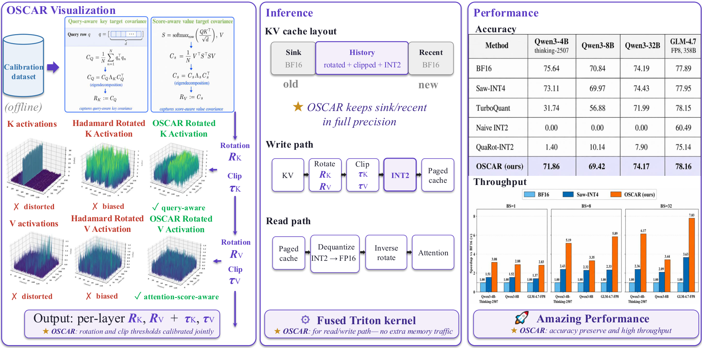

<p align="center">
  
</p>

# OSCAR

### Offline Spectral Covariance-Aware Rotation for 2-bit KV Cache Quantization

<p align="center">
  <a href="https://arxiv.org/pdf/2605.17757"></a>
  <a href="https://oscar-quantize.github.io/"></a>
  <a href="https://huggingface.co/Zhongzhu/OSCAR-RotationZoo"></a>
  <br/>
  <a href="https://huggingface.co/Zhongzhu/OSCAR-LLAMACPP-Qwen3-32B-INT2-KV"></a>
  <a href="https://huggingface.co/Zhongzhu/OSCAR-LLAMACPP-Gemma-4-12B-it-INT2-KV"></a>
  <a href="https://huggingface.co/Zhongzhu/OSCAR-LLAMACPP-Qwen3-4B-Thinking-2507-INT2-KV"></a>
</p>

OSCAR stores the bulk of the KV cache in **2 bits** and keeps only a small BF16 sink and recent window. Each (layer, KV head) gets a rotation built from attention-aware covariance (an eigenbasis followed by a Hadamard, so every channel carries a similar share of the energy), a key mean that is subtracted before quantization, and a clipping threshold, so that four levels per row are enough. The rotation is fit **at server start** or offline on a small calibration set. With the per-row scale and zero included this is 2.25–2.5 bits per element: **6–7× more KV tokens than BF16 in the same memory** on most models, 4× for MLA latents. At 128K context and batch 1 the INT2 decode runs at **1.03–1.16× FlashInfer BF16 on H100** for dense models and 0.73–0.94× on B200.

<p align="center">
  
</p>

This repository is upstream SGLang `main` with the OSCAR low-bit KV cache added under `python/sglang/`. A llama.cpp port (Metal and CPU) lives on the [`zhongzhu/llamacpp`](https://github.com/FutureMLS-Lab/OSCAR/tree/zhongzhu/llamacpp) branch, and pre-fit rotations are on the [RotationZoo](https://huggingface.co/Zhongzhu/OSCAR-RotationZoo).

## 🔥 Latest News
- **[2026-10-12]** Main results refreshed for **13 models** on the current tree (commit `9105559e8e`, upstream base `67eab57057`): GPQA-Diamond at a 64K budget, KL against BF16 at 128K on PG-19, and 128K decode on B200 and H100. On H100 the INT2 decode is **faster than FlashInfer BF16** on dense models (1.03–1.16× at 128K, batch 1); on B200 it is 0.73–0.94× after raising the default INT2 split cap to 256 and dequantizing with a bf16 bit trick. Most recipes now use per-(layer, KV head) rotations with key centering and a per-head K clip.
- **[2026-10-03]** OSCAR moved onto **upstream SGLang main** (base `67eab57057`, the official nightly of 2026-10-02): the repository root is upstream and OSCAR is the diff. Every INT2 arm runs the model's own attention (DSA for GLM-5.x, MSA for MiniMax-M3, MLA + KDA across two nodes for Kimi-K3). Rotations can be **fit at server start**, and 1-bit / 1.5-bit K via product quantization ships as an opt-in tier.
- **[2026-10-03]** Dense INT2 decode on B200 went from 2–3.9× to 1.2–1.5× of FlashInfer BF16 at 64K / batch 1: a separate INT2 split cap, a fused HP + INT2 stage-1, batched decode rotations, a parallel stage-2 and a parallel metadata build, all default-on and checked bit-for-bit against the two-launch path.
- **[2026-06-26]** OSCAR is PRing into **vLLM** too, bringing INT2 KV cache support to another high-throughput serving stack.
- **[2026-06-07]** OSCAR INT2 KV cache now runs **256K Gemma 4 12B under <code style="color : Red">!!16GB!!</code>** and **Qwen3** on the [`zhongzhu/llamacpp` llama.cpp fork](https://github.com/FutureMLS-Lab/OSCAR/tree/zhongzhu/llamacpp) — **~8× smaller KV at near-f16 quality**, with [pre-built `*-rot-kv.gguf` on Hugging Face](https://huggingface.co/Zhongzhu/OSCAR-LLAMACPP-Gemma-4-12B-it-INT2-KV). RUN GEMMA 4 / QWEN3 with LONG CONTEXT on your LOCAL MAC!
  <details>
  <summary> <b>MacBook M5 Max Gemma 4 12B OSCAR INT2 KV Local Run Video</b></summary>
  
  </details>

<details>
<summary><b>More news</b></summary>

- **[2026-06-05]** OSCAR now runs its INT2 KV cache through a fused mixed-precision Flash-Attention kernel on Apple Metal in the [`zhongzhu/llamacpp` llama.cpp fork](https://github.com/FutureMLS-Lab/OSCAR/tree/zhongzhu/llamacpp), making long-context decode up to ~15× faster (near-BF16) at ~7× less KV memory. Try to RUN QWEN-3-32B with LONG CONTEXT in your LOCAL MAC!
  <details>
  <summary><b>MacBook M5 Max Qwen3-32B OSCAR INT2 KV Local Run Screenshot</b></summary>
  
  </details>
- **[2026-06-04]** OSCAR now supports **Gemma 4 12B** with **SGLang INT2 KV cache** on the [`zhongzhu/gemma4-12b`](https://github.com/FutureMLS-Lab/OSCAR/tree/zhongzhu/gemma4-12b) branch.
- **[2026-05-31]** OSCAR is now runnable on the zhongzhu/llamacpp branch of **llama.cpp**. Feedback and suggestions are very welcome!
- **[2026-05-23]** OSCAR released the Qwen3.5 4B, 35B-A3B and MiniMax-M2.7 229B preview results (branch zhongzhu/hybrid-model at the time; these models now run from this tree).
- **[2026-05-18]** Full release: [paper](https://arxiv.org/pdf/2605.17757), code, [website](https://oscar-quantize.github.io/), and [RotationZoo](https://huggingface.co/Zhongzhu/OSCAR-RotationZoo) are all live — runs out of the box on **SGLang**.

</details>

## 📖 Table of Contents
- [Main results](#main-results)
- [Quick start](#-quick-start)
- [Supported models](#supported-models)
- [Advanced usage](#advanced-usage)
- [Layout](#layout)
- [Troubleshooting](#troubleshooting)
- [Citation](#citation)
- [License & acknowledgements](#license--acknowledgements)

## Main results

Numbers are from this tree's serving code (commit `9105559e8e` on upstream SGLang `67eab57057`; some runs used its parent `ff8cadade7`, which differs only in an evaluation script), except where marked ². The INT2 arm and its BF16 control share one launch path and differ only in the KV cache.

| Model | Attention (INT2 path) | GPQA-Diamond BF16 → INT2 | KL@128K ↓ | Decode @128K, B200: INT2 / BF16 tok/s | Decode @128K, H100: INT2 / BF16 tok/s | KV tokens vs BF16 |
|:---|:---|:---:|:---:|:---:|:---:|:---:|
| Qwen3-4B-Thinking-2507 | dense GQA | 66.7 → 60.1 | 0.096 | 124.7 / 157.8 (0.79×) | 111.0 / 96.0 (**1.16×**) | 6.4× |
| Qwen3-8B | dense GQA | 59.1 → 55.6 | 0.097 | 110.4 / 134.3 (0.82×) | 91.2 / 79.1 (**1.15×**) | 6.4× |
| Qwen3-32B | dense GQA | 62.6 → 64.1 | 0.087 | 72.9 / 87.3 (0.84×) | 55.5 / 53.2 (**1.04×**) | 6.4× |
| Qwen3-30B-A3B | MoE, dense GQA (4 KV heads) | 62.6 → 56.6 | 0.104 | 189.3 / 237.5 (0.80×) | 174.0 / 168.6 (**1.03×**) | 6.4× |
| Qwen3.5-4B | hybrid GatedDeltaNet + GQA | 76.3 → 76.8 | 0.031 | 232.7 / 276.7 (0.84×) | 193.6 / 185.4 (**1.04×**) | 7.1× |
| Qwen3.5-35B-A3B | hybrid GatedDeltaNet + GQA, MoE | 80.8 → 81.3 | 0.032 | 259.4 / 307.4 (0.84×) | 271.3 / 283.7 (0.96×) | 7.1× |
| Qwen3.8-27B | hybrid GatedDeltaNet + GQA | 88.4 → 86.9 | 0.029 | 125.5 / 139.4 (0.90×) | 79.9 / 79.7 (1.00×) | 7.1× |
| Gemma-4-12B-it | hybrid SWA, two head geometries | 64.1 → 62.6 | 0.175 | 98.9 / 165.1 (0.60×) ¹ | 73.5 / 30.0 ¹ | 5.1× |
| MiniMax-M2.7 | dense GQA, FP8 weights | 83.3 → 83.8 | 0.077 | 104.7 / 111.4 (0.94×) | 131.6 / 119.6 (**1.10×**) | 6.4× |
| MiniMax-M3 | VL-MoE, MSA sparse | 90.9 → 87.4 ² | 0.039 | 95.5 / 120.0 (0.80×) | — ³ | 3.4× |
| GLM-4.7-FP8 | dense GQA, FP8 weights | 80.8 → 77.8 ² | 0.102 | 58.5 / 79.9 (0.73×, TP 4) | 85.2 / 83.9 (**1.02×**, TP 8) | 6.4× |
| GLM-5.3 | MLA + DSA sparse, packed 2-bit latent | 90.4 → 86.9 | 0.040 | 93.3 / 112.9 (0.83×) | — ³ | 3.7× |
| Kimi-K3 | MLA + KDA hybrid, packed 2-bit latent | 91.9 → 90.9 | 0.012 | 36.9 / 47.7 (0.77×) ¹ | — ³ | 4.0× |

- **GPQA-Diamond:** all 198 questions, 64K generation budget, one seed. Identical repeat runs of one configuration spread by about ±2.7 pp, so gaps under ~5 pp are within noise.
- **KL@128K:** KL(BF16 ‖ INT2) in nats per token on PG-19 books (first 131,072 tokens of each, second half scored, every 32nd position), through the serving path with 512-token prefill chunks, so each position reads at most the last 512 tokens in BF16 and the rest of its history from the INT2 tier, as in decode. Lower is better.
- **Decode:** batch 1, a 128K-token prompt and 512 generated tokens, median of three, both arms in the same pod. The BF16 arm is FlashInfer unless noted.
- **KV tokens:** tokens the INT2 pool holds versus the BF16 pool at the same memory fraction, with the BF16 windows and the fp32 per-row scale and zero included (2.5 bits per element at head_dim 128, 2.25 at head_dim 256). MLA rows store a packed 2-bit latent (288 vs 1152 B per token per layer, 4.00×); the MiniMax-M3 and GLM-5.3 pools also hold BF16 sparse-index caches that stay unquantized.
- ¹ BF16 arm: Gemma-4 uses `trtllm_mha` on B200 and `triton` on H100 (no FlashInfer path serves it, so its H100 pair is not like-for-like); Kimi-K3 uses `trtllm_mla` on two nodes (TP 8 × PP 2).
- ² INT2 arm measured on an earlier tree of the same upstream base; the re-run on the current image is pending.
- ³ The model does not fit one 8 × H100 node.
- Recipes (windows, levels, parallelism) are in `rotation/run/<model>.sh`; the Kimi-K3 row used 128 / 512 BF16 windows, where its script defaults to 64 / 256. Most dense and hybrid rows use a per-(layer, KV head) rotation with key centering, uniform INT2 levels and a K clip chosen per head on calibration rows; Gemma-4 and MiniMax-M2.7 use one global K clip, MiniMax-M2.7 and GLM-4.7 head-resolved output-aware values, GLM-4.7 Lloyd-Max levels, and MiniMax-M3 a layer-shared rotation.

## 🚀 Quick start

**1. Build the image** (one image serves every model; the base is the official SGLang nightly this tree is merged onto):

```bash
git clone --recursive https://github.com/FutureMLS-Lab/OSCAR.git && cd OSCAR
mkdir -p ctx/oscar-src
git archive --format=tar HEAD | tar -x -C ctx/oscar-src
git -C third_party/simple_evals archive --format=tar HEAD | tar -x -C ctx/oscar-src/third_party/simple_evals
printf '%s %s\n' "$(git branch --show-current)" "$(git rev-parse --short HEAD)" > ctx/oscar-src/BUILT_FROM
hf download Zhongzhu/OSCAR-RotationZoo --local-dir ctx/rotations/zoo
docker build -f docker/Dockerfile.oscar --build-arg IMAGE_TAG="$(git rev-parse --short HEAD)" -t oscar-env:local ctx
```

**2. Serve a model with an INT2 KV cache.** Without a rotation file the server fits one at startup (a prefill-only pass over GPQA-Diamond prompts, about 20–45 s), then takes traffic:

```bash
docker run --gpus all --rm -it --shm-size 32g -p 30000:30000 \
  -v "$HOME/.cache/huggingface:/root/.cache/huggingface" -e HF_TOKEN oscar-env:local bash

# inside the container: the Qwen3-8B recipe's windows and clips
SGLANG_ENABLE_MIXED_KV_WINDOWS=1 \
SGLANG_MIXED_KV_PREFIX_TOKENS=128 SGLANG_MIXED_KV_RECENT_TOKENS=512 \
SGLANG_OSCAR_K_CLIP_RATIO=0.96 SGLANG_OSCAR_V_CLIP_RATIO=0.92 \
python -m sglang.launch_server --model-path Qwen/Qwen3-8B \
  --kv-cache-dtype int2 --kv-cache-quant-group-size 128 \
  --attention-backend triton --host 0.0.0.0 --port 30000
```

Set the windows and clips explicitly: the server's own defaults (32 / 128 windows, no clipping) are not a recipe.

```bash
curl http://localhost:30000/v1/chat/completions -H 'Content-Type: application/json' \
  -d '{"model": "Qwen/Qwen3-8B", "messages": [{"role": "user", "content": "What is 2-bit KV cache quantization?"}]}'
```

**3. Run GPQA with a model's recipe**, INT2 against its BF16 control:

```bash
oscar-selfcheck                                        # image tag and the commit it was built from
bash /oscar/src/rotation/run/qwen3-8b.sh               # GPQA-Diamond with the INT2 KV cache
KV_MODE=bf16 bash /oscar/src/rotation/run/qwen3-8b.sh  # the paired BF16 control
bash /oscar/src/rotation/verify/all.sh qwen3-8b        # PASS/FAIL garbling smoke, radix cache and CUDA graphs on
```

The recipes read the RotationZoo rotation by default; set `ROT_DIR=<dir>` to run your own rotation set, for example the per-head ones from [Per-head rotations](#advanced-usage).

## Supported models

Every model below runs from this tree with `--kv-cache-dtype int2`; there are no feature branches. Dense and hybrid models use the mixed pool (BF16 sink and recent windows, INT2 for the rest); MLA models store the packed 2-bit latent; MiniMax-M3 stages the INT2 rows it selects into BF16 for its MSA kernels.

| Model | Attention (INT2 path) | Recipe | GPUs used for the results |
|:---|:---|:---|:---:|
| `Qwen/Qwen3-4B-Thinking-2507` | dense GQA | `rotation/run/qwen3-4b-thinking.sh` | 1 |
| `Qwen/Qwen3-8B` | dense GQA | `rotation/run/qwen3-8b.sh` | 1 |
| `Qwen/Qwen3-32B` | dense GQA | `rotation/run/qwen3-32b.sh` | 2 |
| `Qwen/Qwen3-30B-A3B` | MoE, dense GQA | `rotation/run/qwen3-30b-a3b.sh` | 2 |
| `Qwen/Qwen3.5-4B` | hybrid GatedDeltaNet + GQA | `rotation/run/qwen3.5-4b.sh` | 1 |
| `Qwen/Qwen3.5-35B-A3B` | hybrid GatedDeltaNet + GQA, MoE | `rotation/run/qwen3.5-35b-a3b.sh` | 4 |
| `Qwen/Qwen3.8-27B` | hybrid GatedDeltaNet + GQA | `rotation/run/qwen3.8-27b.sh` | 2 |
| `google/gemma-4-12B-it` | hybrid SWA, two head geometries | `rotation/run/gemma-4-12b.sh` | 1 |
| `MiniMaxAI/MiniMax-M2.7` | dense GQA, FP8 weights | `rotation/run/minimax-m2.7.sh` | 4 |
| `MiniMaxAI/MiniMax-M3` | VL-MoE, MSA sparse | `rotation/run/minimax-m3.sh` | 8 |
| `zai-org/GLM-4.7-FP8` | dense GQA, FP8 weights | `rotation/run/glm-4.7.sh` | 4–8 |
| `zai-org/GLM-5.3` | MLA + DSA sparse, packed 2-bit latent | `rotation/run/glm-5.3.sh` | 8 |
| `zai-org/GLM-5.2-FP8` | MLA + DSA sparse, packed 2-bit latent | `rotation/run/glm-5.2.sh` | 8 |
| `moonshotai/Kimi-K3` | MLA + KDA hybrid, packed 2-bit latent | `rotation/run/kimi-k3.sh` | 16 (TP 8 × PP 2, two nodes) |

## Advanced usage

<details>
<summary><b>Build details and what is in the image</b></summary>

The build context holds this tree as `./oscar-src` and the rotations as `./rotations`; `git archive` leaves submodules out, so the GPQA scorer is archived separately. The build asserts that `import sglang` inside the image resolves to this tree and that the OSCAR modules parse. Kernels are Triton and compile at first use, so the build needs no GPU. Model weights are not in the image.

| Path in the image | Contents |
|---|---|
| `/sgl-workspace/sglang` (also `/oscar/src`) | this tree; the image's editable `sglang` install resolves here |
| `/oscar/rotations/zoo/<model>/` | K/V rotations from the RotationZoo |
| `/oscar/IMAGE_TAG`, `/oscar/BUILT_FROM` | the tag, and the branch and commit the tree came from, so a number from a cluster can be matched to the tree that produced it |
| `/usr/local/bin/oscar-selfcheck` | prints the tag and commit, torch and the CUDA device, then `OSCAR_SELFCHECK_OK` once `import sglang` resolves to this tree |

Run `oscar-selfcheck` on a GPU node before trusting a long job to an image: it is the one check that exercises the driver.

</details>

<details>
<summary><b>Without Docker</b></summary>

Any environment that runs upstream SGLang at commit `67eab57057` runs OSCAR: install this tree's `python/` package in place of `sglang`, with the sgl-kernel and flashinfer builds the official nightly pins (CUDA 13.0, torch 2.13, transformers 5.17, flashinfer 0.7, sglang-kernel 0.4.8). OSCAR adds no compiled extension of its own. If you lay the tree over an existing install by hand, keep that install's prebuilt Rust extensions (`python/sglang/srt/**/*.so`): without the radix-tree core, models on `UnifiedRadixCache` fail at startup. `docker/Dockerfile.oscar` shows the exact steps.

</details>

<details>
<summary><b>Server flags for a manual launch</b></summary>

The recipes set all of this; the underlying launch is:

```bash
SGLANG_ENABLE_MIXED_KV_WINDOWS=1 \
SGLANG_OSCAR_K_ROTATION_PATH=.../k_rotation_qqt_r_h_pbr.pt \
SGLANG_OSCAR_V_ROTATION_PATH=.../v_rotation_sst_r_h_pbr.pt \
SGLANG_OSCAR_K_CLIP_RATIO=0.96 \
SGLANG_OSCAR_V_CLIP_RATIO=0.92 \
SGLANG_MIXED_KV_PREFIX_TOKENS=128 \
SGLANG_MIXED_KV_RECENT_TOKENS=512 \
python -m sglang.launch_server \
  --model-path <model> \
  --tensor-parallel-size <tp> \
  --kv-cache-dtype int2 \
  --kv-cache-quant-group-size 128 \
  --attention-backend triton \
  --trust-remote-code
```

| Env | Server default | Recipes | Effect |
|---|---|---|---|
| `SGLANG_MIXED_KV_PREFIX_TOKENS` / `SGLANG_MIXED_KV_RECENT_TOKENS` | 32 / 128 | 64 / 256 (Qwen3-8B 128 / 512) | BF16 sink and recent window; everything else is INT2 in groups along head_dim |
| `SGLANG_OSCAR_K_CLIP_RATIO` / `SGLANG_OSCAR_V_CLIP_RATIO` | 0 / 0 (no clip) | 0.96 / 0.92 | per-row clipping before min-max quantization |
| `SGLANG_OSCAR_K_CLIP_PER_LAYER` | `` | | per-layer K clip: a comma list in layer order, or a JSON file `{layer: ratio}` |
| `SGLANG_OSCAR_K_CLIP_PER_HEAD` | `` | | per-(layer, KV head) K clip: a JSON file `{"<layer>,<kv head>": ratio}`; heads it does not name keep the layer value |
| `SGLANG_MIXED_KV_SCALE_DTYPE` | `float32` | `float32` | dtype of the per-row scale and zero |
| `SGLANG_OSCAR_ABSORB_V_ROTATION` | off | off | fold the V rotation into the weights instead of applying it at runtime |

</details>

<details>
<summary><b>Use a pre-fit rotation from the RotationZoo</b></summary>

```bash
hf download Zhongzhu/OSCAR-RotationZoo --include "Qwen3-8B/*" --local-dir rotzoo
ROT=$(ls -1d rotzoo/Qwen3-8B/seq*_prompt*_group128 | tail -1)
export SGLANG_OSCAR_K_ROTATION_PATH=$ROT/k_rotation_qqt_r_h_pbr.pt
export SGLANG_OSCAR_V_ROTATION_PATH=$ROT/v_rotation_sst_r_h_pbr.pt
```

Rotations are per model and do not transfer between models; a missing file at 2 bits is collapse, not a mild regression.

</details>

<details>
<summary><b>Fit the rotation at server start</b></summary>

When the mixed pool is active and the rotation pair is unset or missing, the server fits it before it accepts traffic: the pool starts on identity rotations, a prefill-only pass over calibration prompts collects the moments in the attention layers, the scheduler reduces them over TP and decomposes them in FP64, and the rotations are installed in place (captured decode CUDA graphs stay valid). The pair is written atomically under a lock and later launches load it from `$HF_HOME/oscar-rotations/<model>-<digest>/`.

| Env | Default | Effect |
|---|---|---|
| `SGLANG_OSCAR_CALIBRATION_PROMPTS_PATH` | `` | JSONL of `{"messages": [...]}` prompts (or a GPQA CSV); empty = GPQA-Diamond |
| `SGLANG_OSCAR_CALIBRATION_TOKENS` | 30000 | prompt tokens observed per layer |
| `SGLANG_OSCAR_CALIBRATION_BATCH_SIZE` | 32 | prompts per calibration request |
| `SGLANG_OSCAR_CALIBRATION_TIMEOUT` | 1800 | seconds before the launch fails |
| `SGLANG_OSCAR_CALIBRATION_LOCK_DIR` | `/tmp/sglang-oscar-locks` | lock files that serialize pair publication |
| `SGLANG_OSCAR_CALIBRATION_SAVE_MOMENTS` | 0 | also save the per-(layer, KV head) moments, the input to the per-head fitter below |

Limits: single node, DP = PP = 1, no HiCache, no torch.compile, no explicit prefill CUDA-graph backend; the first launch keeps the V rotation at runtime. For long-context serving, calibrate on prompts as long as the contexts you serve: a rotation fit on short prompts degrades at positions it never saw.

</details>

<details>
<summary><b>Per-head rotations, key centering and output-aware values</b></summary>

Rotation checkpoints can carry three optional companions of `rotation`; each defaults to the plain orthogonal behaviour when absent, so older files load unchanged.

| Field (file) | Meaning | Where it acts |
|:---|:---|:---|
| `q_rotation` (K) | query-side matrix `R_k⁻ᵀ` of a non-orthogonal key transform, so `(q·q_rotation)·(k·rotation) = q·k` | prefill and decode queries |
| `o_rotation` (V) | `R_v⁻ᵀ` of a non-orthogonal value transform; the output is un-rotated as `o·o_rotationᵀ` | prefill and decode output |
| `k_mean` (K) | per-head key mean subtracted before the key rotation | every stored key; all logits of a request shift by one constant, so the softmax is unchanged |

Shapes follow `rotation`: `[hd, hd]` (shared) or `[kv_heads, hd, hd]` (per head). Launch once with `SGLANG_OSCAR_CALIBRATION_SAVE_MOMENTS=1`, then fit any variant from the saved moments:

```bash
python rotation/tools/fit_oscar2_variants.py --moments-dir $CAL --out $OUT \
    --variants perhead,center,outaware_hr --model Qwen/Qwen3-8B
ROT_DIR=$OUT/center bash rotation/run/qwen3-8b.sh
```

| Variant | Keys | Values |
|:---|:---|:---|
| `perhead` | orthogonal per KV head, `E_q H P_br` | orthogonal, `E_v H P_br` |
| `center` | `perhead` + `k_mean` (the recipe of the results table) | same |
| `outaware_hr` | `center` | head-resolved post-`W_O` metric `G_h^{1/2} E_v H P_br`, weighted by the query heads' co-attention |
| `whiten`, `flat`, `stretch` | non-orthogonal compact bases | same |

The fitter checks on every file that `q'·k' = q·k` and that `o_rotation` inverts the value transform. The non-orthogonal key bases collapse at long context under scalar INT2 and are kept for ablations only.

</details>

<details>
<summary><b>Offline calibration pipeline (dump, fit, evaluate)</b></summary>

```bash
bash rotation/qwen3-8B/save_qkv_8b.sh          # 1. dump Q/K/V on calibration prompts
bash rotation/qwen3-8B/compute_rotation.sh     # 2. fit {k,v}_rotation_*.pt from the dump
ROT_DIR=$(ls -1d rotation/qwen3-8B/GPQA/seq*_prompt*_group*/rotations | tail -1) \
  bash rotation/qwen3-8B/eval_gpqa.sh          # 3. GPQA against the new rotation
```

How the rotation is fit: for each layer, the key covariance seen by attention (`Σ_K`, the query second moment of the query heads reading each KV head) and a score-weighted value covariance (`Σ_V`) are eigendecomposed; the loaded rotation is `R · H · P_br` (eigenvectors, a head-dim Hadamard, and a bit-reversal permutation that spreads high-variance directions across quantization groups).

| Env (`save_qkv_<model>.sh ENV=val`) | Default | Effect |
|---|---|---|
| `DUMP_KVCACHE_TOKENS` | 30000 | total calibration token budget |
| `GROUP_SIZE` | 128 | KV quant group size, encoded in the output directory name |
| `DATASET` | GPQA | calibration dataset |
| `MODEL` / `TP_SIZE` / `GPU` | per model | model id, tensor parallel size, `CUDA_VISIBLE_DEVICES` |
| `HF_HOME` | `$HOME/.cache/huggingface` | Hugging Face cache |

</details>

<details>
<summary><b>1-bit and 1.5-bit K with product quantization</b></summary>

The quant tier's encoder is selectable per tensor. `pq` stores each row as uint8 codes against a per-layer codebook trained on the rotated activations (16 codes for head_dim 128 = 1.0 bit per value); a codebook with a second stage adds a nibble-packed residual code (RVQ, 1.5 bits per value).

```bash
SGLANG_OSCAR_K_QUANTIZER=pq SGLANG_OSCAR_PQ_K_CODEBOOK=$ROT/codebooks/k_pq_n16_c256_d8.pt       # K 1.0 bit, V INT2
SGLANG_OSCAR_K_QUANTIZER=pq SGLANG_OSCAR_PQ_K_CODEBOOK=$ROT/codebooks/k_rvq_n16_c256x16_d8.pt   # K 1.5 bit (RVQ)
SGLANG_OSCAR_V_QUANTIZER=pq SGLANG_OSCAR_PQ_V_CODEBOOK=$ROT/codebooks/v_pq_n16_c256_d8.pt       # with K pq: V 1.0 bit too
python rotation/tools/train_pq_codebooks.py --dumps $CALIB/qkv_dumps/gpqa \
  --rotation $CALIB/rotations/k_rotation_qqt_r_h_pbr.pt --tensor k --out codebooks/k_pq_n16_c256_d8.pt
```

At 1–1.5 bits the accuracy lives in the BF16 window: treat PQ as a memory lever for contexts long enough to amortize it, not as an accuracy-neutral tier. PQ decode is slower than INT2, and PQ is not available on the two-geometry (Gemma-4), MiniMax-sparse or packed-MLA pools.

</details>

<details>
<summary><b>Decode-speed knobs (dense INT2 path)</b></summary>

All are on by default; each can be switched off on its own for an A/B.

| Env | Default | What it changes |
|:---|:---:|:---|
| `SGLANG_INT2_MAX_SPLITS` | `256` | split ceiling for the INT2 tier; batch-1 decode needs many programs to fill the GPU, most of all on MoE models with few KV heads |
| `SGLANG_OSCAR_FUSED_STAGE1` | `1` | one grid for the BF16 window and the INT2 tier instead of two launches; bit-identical to the two-launch path |
| `SGLANG_OSCAR_FAST_ROT` | `1` | decode `q @ R_k` and `o @ R_vᵀ` as one Triton launch each, per-KV-head rotations read in place |
| `SGLANG_INT2_FAST_STAGE2` | `1` | reduce the split partials in parallel over head_dim slices instead of one serial loop per head |
| `SGLANG_OSCAR_FAST_METADATA` | `1` | build the per-step BF16/INT2 index lists with one program per 512-token block |
| `SGL_INT2_BLOCK_N` / `SGL_INT2_BLOCK_H` / `SGL_INT2_NUM_WARPS` / `SGL_INT2_NUM_STAGES` | shape-dependent | stage-1 tile |

</details>

<details>
<summary><b>Garbling smoke (radix cache and CUDA graphs on)</b></summary>

`rotation/verify/all.sh` serves a model from the image with radix cache and CUDA graphs on, sends probes through the chat template, and judges each output on shape checks. `PASS` means the output did not collapse, not that it is correct. One probe checks recall after a long generation: a four-option question sits in the BF16 window at prefill and is demoted to INT2 by the decode flush; after at least 700 words of reasoning the chosen option must be copied verbatim, otherwise `FAIL(no-recall)`.

| Model | Smoke on this base (`67eab57057`) |
|---|---|
| Qwen3-4B-Thinking-2507, Qwen3-8B, Qwen3-32B, Qwen3-30B-A3B | PASS |
| Qwen3.5-4B, Qwen3.5-35B-A3B, Qwen3.8-27B | PASS |
| Gemma-4-12B-it | PASS |
| MiniMax-M2.7, MiniMax-M3 | PASS |
| GLM-4.7-FP8, GLM-5.2-FP8, GLM-5.3 | PASS |
| Kimi-K3 | checked inside its two-node GPQA job (the sweep pod has eight GPUs, K3 needs sixteen) |

</details>

## Layout

```
python/sglang/                  upstream SGLang main + the OSCAR low-bit KV cache
  srt/mem_cache/unified_kv_pool.py                      mixed pool: BF16 sink/recent windows + INT2 tier
  srt/mem_cache/unified_kv_allocator.py, allocation.py  two-tier allocator, per-request layout and flush schedule
  srt/mem_cache/mla_packed_kv_pool.py                   packed 2-bit MLA latent (GLM-5.x, Kimi-K3)
  srt/mem_cache/minimax_int2_kv_pool.py                 MiniMax-M3 pool (INT2 rows staged to BF16 for MSA)
  srt/mem_cache/oscar_calibration.py                    startup calibration: moments, TP reduction, eigensolve
  srt/mem_cache/oscar_pq_codebooks.py                   1-bit / 1.5-bit product-quantized tier
  srt/layers/attention/triton_ops/decode_attention.py   INT2 decode kernels (fused BF16 + INT2 stage-1, split-KV)
  srt/layers/attention/triton_ops/mla_packed_decode.py  packed-latent MLA decode
  srt/layers/attention/quantized_kv_prefill.py          INT2 prefix dequant for extend and chunked prefill
  srt/entrypoints/oscar_startup_calibration.py          calibrate before the server takes traffic
  QuantKernel/                                          write-side kernels: rotate + clip + quantize, decode flush, PQ
rotation/
  run/<model>.sh                one recipe per model (KV_MODE=bf16 for the control)
  verify/all.sh                 garbling smoke
  eval_oscar_gpqa.sh            launch + GPQA driver that every recipe wraps
  <model>/                      offline calibration: save_qkv_*.sh, compute_rotation.sh, eval_gpqa.sh
  compute_kv_rotation.py        offline eigensolve and R·H·P_br composition
  compute_mla_*_rotation.py     MLA latent rotations
  tools/                        per-head fitter, MLA joint-latent fitter, PQ codebook trainer, OptR trainer
  _eval_runner/                 GPQA / AIME / MATH500 / HumanEval runners, long-context PPL and KL, decode bench
  tests/                        CPU and GPU tests
  examples/, porting/           recipe table; how to port a new model
  OSCAR-RotationZoo/            two sample rotation sets; the full zoo is on Hugging Face
docker/Dockerfile.oscar         the image: official SGLang nightly + this tree
sglang-dump-qkv/                vendored older SGLang used by the offline Q/K/V dump
third_party/simple_evals/       submodule: GPQA scorer (clone with --recursive)
materials/                      figures for this README
```

## Troubleshooting

- **Hybrid models (Qwen3.5, Qwen3.8, Kimi-K3).** Their prefix cache needs `--mamba-radix-cache-strategy extra_buffer` (the recipes set it); without it the Mamba radix cache asserts `page_size == 1`, which surfaces asynchronously as an illegal memory access.
- **Qwen3 dense models past 40,960 tokens.** The recipes enable Qwen's YaRN ×4 recipe when the requested context exceeds 32K. When launching by hand under transformers 5, pass the YaRN dict as both `rope_parameters` and `rope_scaling` and raise `max_position_embeddings`; `rope_scaling` alone is silently ignored.
- **Missing rotation file.** At 2 bits a missing rotation is collapse, not a mild regression; the recipes stop with `FATAL` instead of serving without one.
- **Running locally on a Mac.** Use the `zhongzhu/llamacpp` branch or the pre-built `*-rot-kv.gguf` files on Hugging Face.

## Citation

```bibtex
@misc{zhou2026oscarofflinespectralcovarianceaware,
      title={OSCAR: Offline Spectral Covariance-Aware Rotation for 2-bit KV Cache Quantization},
      author={Zhongzhu Zhou and Donglin Zhuang and Jisen Li and Ziyan Chen and Shuaiwen Leon Song and Ben Athiwaratkun and Xiaoxia Wu},
      year={2026},
      eprint={2605.17757},
      archivePrefix={arXiv},
      primaryClass={cs.LG},
      url={https://arxiv.org/abs/2605.17757},
}
```

## License & acknowledgements

- Released under the MIT License.
- Built on top of [sglang](https://github.com/sgl-project/sglang).
