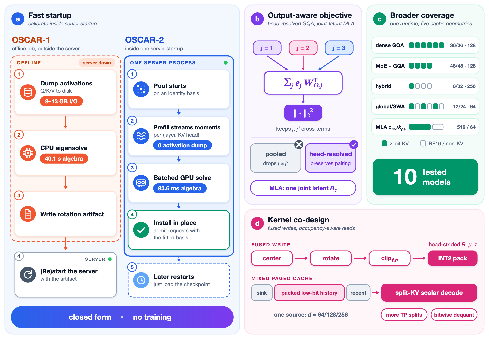
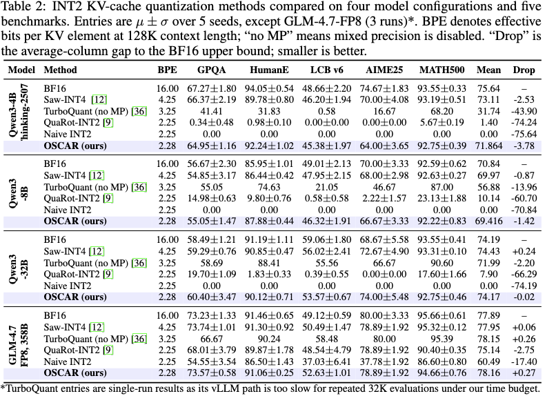

<p align="center">
  
</p>

# OSCAR-2

### Plug-and-Play 2-Bit KV Cache Serving with Head-Resolved GQA and Joint-Latent MLA Calibration

<p align="center">
  <a href="https://arxiv.org/pdf/2605.17757"></a>
  <a href="https://oscar-quantize.github.io/"></a>
  <a href="https://huggingface.co/Zhongzhu/OSCAR-RotationZoo"></a>
  <br/>
  <a href="https://huggingface.co/Zhongzhu/OSCAR-LLAMACPP-Qwen3-32B-INT2-KV"></a>
  <a href="https://huggingface.co/Zhongzhu/OSCAR-LLAMACPP-Gemma-4-12B-it-INT2-KV"></a>
  <a href="https://huggingface.co/Zhongzhu/OSCAR-LLAMACPP-Qwen3-4B-Thinking-2507-INT2-KV"></a>
</p>

A 2-bit KV cache that calibrates itself during server startup and serves every cache geometry with one checkpoint format and one kernel family: **6–7× more KV tokens than BF16** (4× for MLA latents).

<p align="center">
  
</p>

Upstream SGLang `main` + OSCAR-2 · OSCAR-1: [paper](https://arxiv.org/abs/2605.17757), [`main`](https://github.com/FutureMLS-Lab/OSCAR/tree/main) · llama.cpp: [`zhongzhu/llamacpp`](https://github.com/FutureMLS-Lab/OSCAR/tree/zhongzhu/llamacpp) · rotations: [RotationZoo](https://huggingface.co/Zhongzhu/OSCAR-RotationZoo)

## 🔥 News
- **[2026-11-11]** **OSCAR-2**: calibration at server start, head-resolved GQA / joint-latent MLA objectives, scalar-INT2 Quantizer Family, one kernel family. Paper coming soon.
- **[2026-10-12]** 13 models on the current tree; INT2 decode at **1.03–1.16× FlashInfer BF16 on H100** (128K, batch 1).
- **[2026-10-03]** Rebased onto upstream SGLang `main`; calibration at server start; 1 / 1.5-bit PQ tier.
- **[2026-06-26]** vLLM integration in progress.
- **[2026-06-07]** llama.cpp: 256K-context Gemma 4 12B in **16 GB** on a Mac, ~8× smaller KV ([GGUF](https://huggingface.co/Zhongzhu/OSCAR-LLAMACPP-Gemma-4-12B-it-INT2-KV)).
  <details>
  <summary> <b>MacBook M5 Max Gemma 4 12B OSCAR INT2 KV Local Run Video</b></summary>
  
  </details>

<details>
<summary><b>More news</b></summary>

- **[2026-06-05]** llama.cpp: fused INT2 Flash-Attention on Apple Metal, up to ~15× faster long-context decode.
  <details>
  <summary><b>MacBook M5 Max Qwen3-32B OSCAR INT2 KV Local Run Screenshot</b></summary>
  
  </details>
- **[2026-06-04]** Gemma 4 12B on the SGLang INT2 KV cache.
- **[2026-05-31]** llama.cpp port.
- **[2026-05-23]** Qwen3.5 4B / 35B-A3B and MiniMax-M2.7 previews.
- **[2026-05-18]** Release: [paper](https://arxiv.org/pdf/2605.17757), code, [website](https://oscar-quantize.github.io/), [RotationZoo](https://huggingface.co/Zhongzhu/OSCAR-RotationZoo).

</details>

[What's new](#whats-new-in-oscar-2) · [Main results](#main-results) · [Previous results](#previous-results) · [Quick start](#-quick-start) · [Models](#supported-models) · [Advanced usage](#advanced-usage) · [Layout](#layout) · [Troubleshooting](#troubleshooting) · [Citation](#citation)

## What's new in OSCAR-2

| | OSCAR-1 | OSCAR-2 |
|:---|:---|:---|
| Calibration | offline: dump Q/K/V → CPU solve → separate artifact | at server start: stream moments → GPU solve → install before the first request |
| Objective | pooled covariance per layer | head-resolved post-`W_O` (GQA), one joint latent (MLA) |
| Quantizer | one rotation and clip per layer | per-head rotation + key centering + per-head K clip, one checkpoint format |
| Kernels | per model family | one fused write and one split-KV read for every geometry |

## Main results

GPQA-Diamond (198, 64K budget) · KL(BF16 ‖ INT2) on PG-19 at 128K · decode at 128K, batch 1 · KV tokens at equal memory.

| Model | Attention | GPQA BF16 → INT2 | KL@128K ↓ | Decode B200, INT2 / BF16 tok/s | Decode H100, INT2 / BF16 tok/s | KV tokens |
|:---|:---|:---:|:---:|:---:|:---:|:---:|
| Qwen3-4B-Thinking-2507 | dense GQA | 66.7 → 60.1 | 0.096 | 124.7 / 157.8 (0.79×) | 111.0 / 96.0 (**1.16×**) | 6.4× |
| Qwen3-8B | dense GQA | 59.1 → 55.6 | 0.097 | 110.4 / 134.3 (0.82×) | 91.2 / 79.1 (**1.15×**) | 6.4× |
| Qwen3-32B | dense GQA | 62.6 → 64.1 | 0.087 | 72.9 / 87.3 (0.84×) | 55.5 / 53.2 (**1.04×**) | 6.4× |
| Qwen3-30B-A3B | MoE, dense GQA (4 KV heads) | 62.6 → 56.6 | 0.104 | 189.3 / 237.5 (0.80×) | 174.0 / 168.6 (**1.03×**) | 6.4× |
| Qwen3.5-4B | hybrid GatedDeltaNet + GQA | 76.3 → 76.8 | 0.031 | 232.7 / 276.7 (0.84×) | 193.6 / 185.4 (**1.04×**) | 7.1× |
| Qwen3.5-35B-A3B | hybrid GatedDeltaNet + GQA, MoE | 80.8 → 81.3 | 0.032 | 259.4 / 307.4 (0.84×) | 271.3 / 283.7 (0.96×) | 7.1× |
| Qwen3.8-27B | hybrid GatedDeltaNet + GQA | 88.4 → 86.9 | 0.029 | 125.5 / 139.4 (0.90×) | 79.9 / 79.7 (1.00×) | 7.1× |
| Gemma-4-12B-it | hybrid SWA, two head geometries | 64.1 → 62.6 | 0.175 | 98.9 / 165.1 (0.60×) ¹ | 73.5 / 30.0 ¹ | 5.1× |
| MiniMax-M2.7 | dense GQA, FP8 weights | 83.3 → 83.8 | 0.077 | 104.7 / 111.4 (0.94×) | 131.6 / 119.6 (**1.10×**) | 6.4× |
| MiniMax-M3 | VL-MoE, MSA sparse | 90.9 → 87.4 ² | 0.039 | 95.5 / 120.0 (0.80×) | — ³ | 3.4× |
| GLM-4.7-FP8 | dense GQA, FP8 weights | 80.8 → 77.8 ² | 0.102 | 58.5 / 79.9 (0.73×, TP 4) | 85.2 / 83.9 (**1.02×**, TP 8) | 6.4× |
| GLM-5.3 | MLA + DSA sparse, packed 2-bit latent | 90.4 → 86.9 | 0.040 | 93.3 / 112.9 (0.83×) | — ³ | 3.7× |
| Kimi-K3 | MLA + KDA hybrid, packed 2-bit latent | 91.9 → 90.9 | 0.012 | 36.9 / 47.7 (0.77×) ¹ | — ³ | 4.0× |

¹ BF16 without FlashInfer: Gemma-4 `trtllm_mha` (B200) / `triton` (H100), Kimi-K3 `trtllm_mla` (TP 8 × PP 2). ² INT2 on an earlier tree. ³ Does not fit one 8×H100 node.

## Previous results

Earlier README snapshots, unchanged.

<details>
<summary><b>2026-10-04 · upstream-aligned tree, previews, MLA models</b></summary>

**Results on the upstream-aligned tree**

Base `67eab57057` (upstream SGLang main), B200, radix cache and CUDA graphs on; GPQA-Diamond @64K budget, n=198, single seed unless a cell says otherwise (then the mean over the seeds run on this tree); decode at 64K context, batch 1. Details and ms/tok in the [per-model](#per-model-gpqa-bf16-vs-oscar-int2-this-tree) and [speed](#64k-decode-on-b200-this-tree) tables.

| Model | GPQA BF16 | GPQA INT2 | INT2 decode vs triton BF16 | INT2 decode vs FlashInfer family | Best quantizer |
|:---:|:---:|:---:|:---:|:---:|:---|
| Qwen3-4B-Thinking-2507 | 63.6 | 64.6 | 6.57× faster | 1.27× slower | INT2 uniform, per-head + centering + head-resolved values (PPL@64K 8.819 vs BF16 8.773; zoo 8.930) |
| Qwen3-8B | 58.6 (2 seeds) | 53.3 (2 seeds, uniform levels, 2048-token window; re-measured at 512 in the final sweep) | 5.71× faster | 1.22× slower | INT2 uniform + clip .96/.92, per-head + centering + head-resolved values (PPL@64K 8.481 vs BF16 8.147 at a 512-token window; shared basis 8.837) |
| Qwen3-32B | 64.1 | 59.6 | 5.45× faster | 1.20× slower | INT2 uniform, per-head + centering (PPL@64K 6.515 vs BF16 6.365; zoo 6.684) |
| Qwen3-30B-A3B | 61.1 | 55.3 (2 seeds) | 8.39× faster | 1.40× slower | INT2 uniform, per-head zoo rotation (PPL@64K 10.88 vs BF16 7.78; the calibrated per-head variants read 11.2–11.3, a shared basis 36) |
| Qwen3.5-4B | 79.3 | 75.3 | 3.23× faster | 1.26× slower | INT2 Lloyd-Max, per-head + centering + head-resolved values (PPL@64K 8.627 vs BF16 8.783; zoo 8.965) |
| Qwen3.5-35B-A3B | 81.8 | 83.8 | 3.97× faster | 1.32× slower | INT2 uniform, startup-calibrated layer-shared rotation (PPL@64K 6.522 vs BF16 6.517; per-head variants 6.55–6.67 under TP-replicated KV heads) |
| Gemma-4-12B-it | 63.1 | 64.1 | 2.03× faster | 1.51× slower (trtllm_mha) | INT2 uniform, two-geometry pool |
| MiniMax-M2.7 | 86.9 | 87.9 | 6.66× faster | 1.27× slower | INT2 uniform, per-head + centering + head-resolved values (PPL@64K 6.828 vs BF16 6.783; zoo + Lloyd-Max 6.850) |
| MiniMax-M3 (MSA sparse) | 90.9 | 88.1 (2 seeds) | 1.34× slower | 1.73× slower | INT2 uniform + MSA staging (PPL@64K 4.597 vs BF16 4.462) |
| GLM-4.7-FP8 | 80.8 | 78.8 | 6.54× faster | 1.18× slower | INT2 uniform, layer-shared rotation |
| GLM-5.2-FP8 (DSA sparse) | 87.4 | 83.8 | 1.36× slower | same DSA path | packed 2-bit latent + rotation, 4.00× (PPL@64K 3.034 vs BF16 3.042) |
| GLM-5.3 (DSA sparse) | 87.4 | 84.3 | 1.36× slower | same DSA path | packed 2-bit latent + rotation, 4.00× (PPL@64K 4.192 vs BF16 4.163) |
| Kimi-K3 (TP 8 × PP 2) | 90.9 | 90.4 | 1.33× slower | 1.40× slower (trtllm_mla) | packed 2-bit latent + rotation (4.00×) |

Best quantizer = the best measured K/V quantizer for that model on the 64K PPL ladder (four 65,536-token WikiText-2 windows, tokens ≥ 32,768 scored, each model's recipe windows); every row clips at .96/.92. The GPQA INT2 column still carries the earlier recipe's seeds and is re-measured with these quantizers in the final sweep. Gemma-4's PPL cannot be read through this harness (BF16 itself scores garbage on raw-id /generate), so its row keeps the zoo rotation.

The dense-GQA rows read the same way: INT2 decodes 1.9–3.0× faster than the
triton BF16 arm and 2.0–3.9× slower than the FlashInfer-family kernels. Where
the BF16 arm is already a sparse or MLA-specific kernel (GLM's DSA, MiniMax-M3's
MSA, Kimi-K3's MLA) or the head geometry has no fast path (Gemma-4's 512-wide
heads), INT2 is 1.1–1.4× slower than BF16 on the same backend; the gain there
is the 4× smaller cache, not speed.

<details>
<summary><b>Qwen3.5-4B preview</b></summary>

Qwen3.5 — BF16 vs OSCAR INT2 KV (2-bit, sink 64 / recent 256), mean ± std over 3 seeds (35B-A3B AIME: 8 seeds, N=30 is high-variance). OSCAR quantizer per model best: 4B uniform, 35B-A3B Lloyd-Max.

| Benchmark | BF16 | OSCAR | Δ vs BF16 |
|---|:---:|:---:|:---:|
| GPQA-Diamond | 76.9 ± 1.3 | **75.8 ± 1.6** | −1.2 |
| HumanEval | 81.7 ± 1.8 | **83.9 ± 1.0** | +2.2 |
| AIME 2025 | 47.8 ± 3.1 | **46.7 ± 0.0** | −1.1 |
| MATH500 | 89.5 ± 0.6 | **88.0 ± 0.6** | −1.5 |

</details>

<details>
<summary><b>Qwen3.5-35B-A3B preview</b></summary>

Qwen3.5 — BF16 vs OSCAR INT2 KV (2-bit, sink 64 / recent 256), mean ± std over 3 seeds (35B-A3B AIME: 8 seeds, N=30 is high-variance). OSCAR quantizer per model best: 4B uniform, 35B-A3B Lloyd-Max.

| Benchmark | BF16 | OSCAR | Δ vs BF16 |
|---|:---:|:---:|:---:|
| GPQA-Diamond | 83.3 ± 1.8 | **84.0 ± 1.3** | +0.7 |
| HumanEval | 83.9 ± 0.6 | **86.6 ± 1.8** | +2.6 |
| AIME 2025 † | 66.7 ± 5.3 | **62.1 ± 4.7** | −4.6 |
| MATH500 | 92.8 ± 0.2 | **91.7 ± 0.4** | −1.1 |

<sub>† AIME N=30 is high-variance; measured over 8 seeds. The −4.6 gap is not statistically significant (Welch t=1.72). At 3 seeds it read −6.7, inflated by a favorable BF16 draw.</sub>

</details>

<details>
<summary><b>MiniMax-M2.7 preview</b></summary>

MiniMax-M2.7 — BF16 vs OSCAR INT2 KV (LM_RATIO=1.16), single run per benchmark.

| Benchmark | BF16 | OSCAR (LM_RATIO=1.16) | Δ |
|---|---|---|---|
| GPQA-Diamond | 0.7828 | **0.7929** | +1.0 pp |
| HumanEval | 0.8817 | **0.8854** | +0.4 pp |
| AIME 2025 | 0.7667 | **0.7667** | 0.0 pp |
| MATH500 | 0.9379 | **0.9279** | −1.0 pp |

</details>

<details>
<summary><b>MLA models — packed 2-bit latent (GLM-5.2, GLM-5.3, Kimi-K3)</b> </summary>

**What is quantized.** MLA stores one shared latent `c_kv` plus a positional
`k_pe`. OSCAR quantizes **the latent** and leaves **`k_pe` in BF16** — the
opposite way round from how it is easy to read. Per token per layer, at
`kv_lora_rank=512`, `qk_rope_head_dim=64`, group 128:

| buffer | bytes | contents |
|---|---:|---|
| `c_codes` | 128 | the 512-dim latent at **2 bits**, 4 per byte |
| `c_params` | 32 | (scale, zero) fp32 per quantization group |
| `rope_buf` | 128 | `k_pe`, **BF16, never quantized** |
| **total** | **288** | vs BF16's `(512+64)·2 = 1152` → **4.00×** |

`k_pe` staying BF16 is load-bearing: it is the positional half of the MLA key
and 2-bit'ing it destroys the rope term. It is also **44% of the cell**, which
caps this axis — a latent compressed to zero bits would still leave 256 B, i.e.
**4.5× is the ceiling**, and the shipped 4.00× already sits just under it.

**GPQA-Diamond, full 198 questions, `max_tokens=32768`, single seed.** Same
question set and permutations across arms (`Random(0)`), so the rows are paired.

| Model | BF16 | packed 2-bit (4.00×) | Δ |
|---|---:|---:|---:|
| GLM-5.2 | 82.32 | 74.75 | −7.57 pp |
| GLM-5.3 | 82.83 | **77.78** | **−5.05 pp** |

At a **64K** generation budget both models are measured on the same 48-question
subset (`n=48`, `max_tokens=65536`). Kept as its own table because neither the
question count nor the budget matches the one above, and the two are not
comparable — but the rows here are comparable to each other:

| Model | budget | n | BF16 | packed 2-bit (4.00×) | Δ |
|---|---|---:|---:|---:|---:|
| GLM-5.2 | 64K | 48 | 87.50 | 83.33 | −4.17 pp |
| **Kimi-K3** | 64K | 48 | **93.75** | **83.33** | **−10.42 pp** |

The two land on the same 83.33 from very different starting points: K3's BF16 is
6.25 pp higher, and 2 bits takes all of that back and more. Whatever is costing
K3 its 10 points is specific to K3, not to the packed path — GLM-5.2 runs the
identical quantiser for less than half the loss.

GLM-5.3 required **zero model-code changes** — `GlmMoeDsaForCausalLM` is
identical to GLM-5.2's — but rotations do **not** transfer between models and
must be refitted from each model's own `c_kv` dump.

**Ratio / accuracy frontier (GLM-5.2, all end-to-end at n=198).** Every knob
inside 2 bits has been measured; none closes the 4.00× gap, and bit width buys
more accuracy per unit of ratio surrendered than group size does:

| config | ratio | GPQA | vs BF16 |
|---|---:|---:|---:|
| 2-bit g128 (shipped) | 4.00× | 74.75 | −7.57 |
| 2-bit g32 | 3.00× | 77.78 | −4.54 |
| 4-bit g128 | 2.77× | 80.81 | −1.51 |
| BF16 | — | 82.32 | — |

**Where K3's loss actually sits.** Adding stock upstream to the same 48
questions separates the quantiser from this fork:

| arm | KV | GPQA |
|---|---|---:|
| stock upstream sglang | BF16 | 95.83 |
| this fork, no quantiser | BF16 | **93.75** |
| this fork, packed 2-bit | 4.00× | **83.33** |

So the serving path costs **2.1 pp** — one question out of 48, inside the noise
of a single 48-question run — and 2-bit costs **10.4 pp**. Reaching 90 is a
bit-width question, not a bug hunt.

K3 pays more for 2 bits than the GLM models do (−4.2 pp for GLM-5.2 at the same
n=48/64K, −5.1 pp for GLM-5.3 at n=198/32K). It is a KDA/MLA hybrid where only
24 layers carry a latent rotation, so the quantisation error concentrates in
far fewer layers instead of being spread across all of them.

Both figures are single runs at n=48; the standard error on each is about
±5 pp, so the 10.4 pp separation is real but its decimals are not.

That gap prompted an attempt to replace K3's model file with upstream's
wholesale. The attempt is recorded here because it failed instructively: the
ported file served but produced word salad, and the next 38 commits went to
repairing its fallout. Two of those repairs were genuine defects in shared
code and were kept — a use-after-free on the KDA decode metadata, and a
`gate_up_interleaved` that was threaded through FusedMoE and never read.
Neither was K3's problem. K3's problem was the replacement. The model line is
back on the file that scored 70.83.

Worth knowing before trying again: K3's chat format is Python
(`encoding_k3.py`), not a jinja template, and its expert weights are
compressed-tensors `mxfp4-pack-quantized` with only the routed experts
quantized. Its `--reasoning-parser kimi_k3` does not exist in this fork, so
thinking is not split out of `content` and any length comparison against
upstream is not like-for-like.

</details>

</details>

<details>
<summary><b>2026-10-04 · OSCAR-2 transform ladder (Qwen3-8B, PPL@64K)</b></summary>

Measured on Qwen3-8B (every row fitted from one startup-calibration pass) at
the recipe's windows of 128 sink / 512 recent tokens. PPL = four 65,536-token
WikiText-2 test windows through the real serving path (chunked prefill
16,384); only tokens at positions ≥ 32,768 are scored (131,072 tokens), so
every scored token attends to 32K–64K keys through the quant tier. "LM" = the
Lloyd-Max std-loaded levels, "uniform" = per-row min-max levels; both clip at
.96/.92. GPQA for these rows is re-measured at the 512 window in the final
sweep (the earlier GPQA seeds were taken at a 2048 window and are not
comparable).

| Row | Keys | Values | Levels | PPL@64K | vs BF16 |
|:---|:---|:---|:---|---:|---:|
| BF16 | — | — | — | 8.147 | — |
| **per-head + centering, head-resolved output-aware values (`outaware_hr`, C2.7)** | + `k_mean` | post-`W_O`, ρ-weighted | **uniform** | **8.481** | **+4.1%** |
| per-head + centering | + `k_mean` | `E_v H P_br` | uniform | 8.495 | +4.3% |
| startup-calibrated, shared | `E_q H P_br` | same | uniform | 8.837 | +8.5% |
| per-head + centering | + `k_mean` | same | LM | 9.371 | +15.0% |
| per-head + centering, head-resolved values | + `k_mean` | post-`W_O`, ρ-weighted | LM | 9.377 | +15.1% |
| startup-calibrated, shared | `E_q H P_br` | same | LM | 9.821 | +20.5% |
| V1 shared zoo rotation | `U_Q H P_br` | same | LM | 10.088 | +23.8% |
| per-head | per-head orthogonal | same | LM | 10.251 | +25.8% |
| fixed-rate stretch | `X*^{1/2} E* H P_br` | same | LM | 222 | collapse |
| whitened compact basis (`whiten`) | `M_q^{1/2} E` | same | LM | 1828 | collapse |
| flat compact basis | `M_q^{1/2} E H P_br` | same | LM | 12821 | collapse |

Three readings. First, the quantizer levels dominate: the Lloyd-Max
std-loaded levels cost 11–15 PPL points over the plain per-row min-max
levels on the same transform (9.821 vs 8.837 shared; 9.371 vs 8.495
centered), so the Qwen3-8B recipe runs uniform levels (`LLOYD_MAX=0`). Second,
with a 512-token BF16 window and 32K–64K quantized keys the OSCAR-2 key
components pay: per-head + centering takes the overhead from +8.5% (shared)
to +4.3%, and the C2.7 head-resolved value transform fitted from the
calibrator's co-attention statistic adds a further small gain (+4.1%); at the
earlier 2048-token window and 16K quantized keys the same rows were all within
noise of BF16 (8.99–9.01 against 8.99), which is why that regime could not
rank them. Third, every non-orthogonal key metric collapses at long context
under scalar quantization, including the fixed-rate stretch that passes the
smoke probe -- a non-orthogonal basis needs a vector quantizer on the read
path, which this fork does not have and does not plan to add. The pooled
post-`W_O` value metric on centered keys was neutral at the 2048 window
(9.125 vs 9.126 at 32K); the head-resolved one is what the recipe carries.

The collapse of the non-orthogonal rows is the method, not the engine. An
offline replay on real Qwen3-8B post-RoPE queries and keys (one 4096-token
WikiText-2 window, 36 layers x 8 KV heads, the write kernel's arithmetic in
fp64, serving path bypassed; keys older than the 2048-token window quantized)
reproduces the ordering as attention KL against exact attention: per-head
0.136, centered 0.072, stretch 0.123, whiten 0.56, flat 2.07 nats. The same
whiten/flat bases with a 2-bit product quantizer (g = 4, 256 centroids) stay at
0.027/0.028: the whitened basis is a vector-quantization basis, and the
method it was borrowed from reports basis + scalar quantization = 0.0 in its
own ablation. Storing the transformed rows in bf16 is not a factor
(BF16-window-only arms: KL <= 0.0005). A Gaussian second-order simulation on
the calibration moments ranks the fixed-rate stretch best, as the theory says;
on real keys its logit RMSE is indeed lowest but its errors are heavier-tailed
(spurious INT2 maxima for 20.7% of queries vs 14.3% for centering), and the
softmax pays for the tail. The tail also explains why stretch passes the
smoke probe and GPQA but collapses at 32K: on a 16384-token window (four
times the INT2 keys) the KL grows 1.4x for per-head and 1.8x for centering
but 6.8x for stretch (0.83 nats), 5x for whiten and 7.5x for flat.

</details>

<details>
<summary><b>2026-10-04 · per-model GPQA and 64K decode</b></summary>

_Knob defaults as of 2026-10-04; the INT2 split cap is now 256._

**Per-model GPQA: BF16 vs OSCAR INT2**

The table is populated only from runs on **this tree at its current upstream
base** (`67eab57057`, nightly image `nightly-dev-20261002-67eab570`); numbers
from earlier bases are not carried over. Both arms of a row share one launch
path (`rotation/run/<model>.sh`) and differ only in `KV_MODE`; GPQA-Diamond is
single-seed unless the cell lists its seeds, all 198 questions, at a 64K generation budget with radix cache
and CUDA graphs on. All thirteen rows below are complete on this base.

**The INT2 arm runs the model's own attention.** GLM-5.2/5.3 run upstream's
DSA sparse attention (flashmla_sparse prefill, trtllm sparse decode) with the
packed 2-bit latent staged per layer; MiniMax-M3 runs upstream's MSA sparse
top-k (indexer on the real token table, INT2 rows dequantized per layer for the
same sparse kernels); Kimi-K3 runs MLA + KDA across two nodes; the rest are
dense GQA. The BF16 control uses the same backend in every row.

| Model | INT2 attention path | n / budget | GPQA (BF16) | GPQA (OSCAR INT2) | Δ |
|:---:|:---:|:---:|:---:|:---:|:---:|
| `Qwen/Qwen3-4B-Thinking-2507` | dense GQA | 198 / 64K | 63.6 | 64.6 | +1.0 |
| `Qwen/Qwen3-8B` | dense GQA | 198 / 64K | 58.6 (2 seeds: 60.6, 56.6) | 53.3 (2 seeds: 52.5, 54.0; uniform levels, startup-calibrated shared rotation. Lloyd-Max levels: 52.8 over 4 seeds) | −5.3 |
| `Qwen/Qwen3-32B` | dense GQA | 198 / 64K | 64.1 | 59.6 | −4.5 |
| `Qwen/Qwen3-30B-A3B` | dense GQA, per-head rotation | 198 / 64K | 61.1 | 55.3 (2 seeds: 55.6, 55.1) | −5.8 (INT2 answers run longer: median 49K vs 32K chars, 12 of 198 hit the budget without a final answer vs 0; same shape as on the previous base) |
| `Qwen/Qwen3.5-4B` | hybrid GDN + GQA | 198 / 64K | 79.3 | 75.3 | −4.0 |
| `Qwen/Qwen3.5-35B-A3B` | hybrid GDN + GQA | 198 / 64K | 81.8 | 83.8 | +2.0 |
| `google/gemma-4-12B-it` | hybrid SWA, two geometries | 198 / 64K | 63.1 | 64.1 | +1.0 |
| `MiniMaxAI/MiniMax-M2.7` | dense GQA | 198 / 64K | 86.9 | 87.9 | +1.0 |
| `MiniMaxAI/MiniMax-M3` | MSA sparse top-k (upstream backend) | 198 / 64K | 90.9 | 88.1 (2 seeds: 88.9, 87.4) | −2.8 (after the indexer-key fix below; 56.6 before it) |
| `zai-org/GLM-5.2-FP8` | DSA sparse (upstream backend), packed latent 4.00× | 198 / 64K | 87.4 | 83.8 | −3.5 (INT2 answers run longer: median 63K vs 32K chars, 24 vs 9 without a final answer) |
| `zai-org/GLM-5.3` | DSA sparse (upstream backend), packed latent 4.00× | 198 / 64K | 87.4 | 84.3 | −3.0 (INT2 answers run longer: median 51K vs 31K chars, 21 vs 8 without a final answer) |
| `zai-org/GLM-4.7-FP8` | dense GQA | 198 / 64K | 80.8 | 78.8 | −2.0 |
| `moonshotai/Kimi-K3` | MLA latent + KDA, packed latent 4.00×, TP 8 × PP 2 | 198 / 64K | 90.9 | 90.4 |  −0.5 (re-measured with the BF16 windows on; the earlier 93.4 came from a run whose packed pool had them silently off) |

**MiniMax-M3 scored 56.6 on the first INT2 run of this base.** The BF16 control
(90.9, same MSA backend) ruled out noise: 47 of 198 INT2 answers had no final
letter and 12 ended by asking for the question after pages of correct reasoning.
The cause was in the INT2 pool, not the kernels: the decode flush demotes
recent-window rows into int2 slots and remaps `req_to_token`, but the lightning
indexer's key rows written at the window slots did not move with them, so after
a few hundred generated tokens the indexer scored every flushed token --
including the question beyond the 64-token BF16 prefix -- against zeros. The
pool now moves those rows in the same step (`on_flush_applied`); the re-run on
the fixed tree scores 88.9 (8/12 discordant against BF16, p = 0.5) with 6
unanswered questions against BF16's 5. The smoke suite gained the verbatim-quote
retention probe described above because every fluency probe had passed on the broken pool.

**64K decode on B200**

Batch size 1, a 65,536-token prompt followed by 512 generated tokens, median
of three repeats; measured on the same base as the GPQA sweep, all thirteen
rows complete. The nine dense rows were then re-measured on the current image
(v88) with the decode-speed knobs below on, one pod per model with all three
arms in that pod; GLM-5.x, MiniMax-M3 and Kimi-K3 run sparse or MLA paths the
knobs do not touch and keep their earlier same-pod numbers. The BF16
column is the same model on the triton backend (what OSCAR's INT2 kernels
replace); the FlashInfer column is the fastest BF16 baseline that serves the
model (for GLM that is upstream's DSA path, for Gemma-4 `trtllm_mha`, the only
FlashInfer-family backend its model file accepts). A GPU keep-alive that the
cluster's idle-pod reaper requires during weight loads is paused while the
server answers `/v1/models`, so no foreign kernel runs during a measurement.
Bench pods get 12 CPU cores per GPU: a 16-core pod throttled a TP 8 model by
~19% in both arms (ratio unchanged), so TP 8 rows come from 96-core pods.

| Model | INT2 ms/tok | BF16 triton ms/tok | INT2 vs BF16 triton | BF16 FlashInfer-family ms/tok | INT2 vs FlashInfer |
|:---:|:---:|:---:|:---:|:---:|:---:|
| Qwen3-4B-Thinking-2507 | 6.10 | 40.09 | 6.57× faster | 4.81 | 1.27× slower |
| Qwen3-8B | 7.23 | 41.23 | 5.71× faster | 5.91 | 1.22× slower |
| Qwen3-32B | 11.23 | 61.17 | 5.45× faster | 9.38 | 1.20× slower |
| Qwen3-30B-A3B | 5.08 | 42.60 | 8.39× faster | 3.62 | 1.40× slower |
| Qwen3.5-4B | 4.09 | 13.21 | 3.23× faster | 3.26 | 1.26× slower |
| Qwen3.5-35B-A3B | 4.08 | 16.18 | 3.97× faster | 3.08 | 1.32× slower |
| Gemma-4-12B-it | 9.08 | 18.43 | 2.03× faster | 6.01 (trtllm_mha) | 1.51× slower |
| MiniMax-M2.7 | 8.85 | 58.98 | 6.66× faster | 6.95 | 1.27× slower |
| GLM-4.7-FP8 | 11.41 | 74.58 | 6.54× faster | 9.71 | 1.18× slower |
| GLM-5.2-FP8 | 11.99 | 8.81 (DSA, same backend both arms) | 1.36× slower | same DSA path (8.81) | 1.36× slower |
| GLM-5.3 | 11.99 | 8.82 (DSA, same backend both arms) | 1.36× slower | same DSA path (8.81) | 1.36× slower |
| MiniMax-M3 | 14.98 | 11.19 (MSA sparse, same backend both arms) | 1.34× slower | 8.67 | 1.73× slower |
| Kimi-K3 (TP 8 × PP 2) | 28.43 | 21.44 (triton MLA) | 1.33× slower | 20.27 (trtllm_mla) | 1.40× slower |

> Every model's serving recipe (rotation set, windows, codebook, parallelism) is `rotation/run/<model>.sh` on this tree; pre-fit rotations for all of them are on the [RotationZoo](https://huggingface.co/Zhongzhu/OSCAR-RotationZoo).

**Decode-speed knobs (dense INT2 path)**

These settings decide how the mixed HP+INT2 decode kernel is launched. All
are on by default; each can be switched off on its own for an A/B.

| Env | Default | What it changes |
|:---|:---:|:---|
| `SGLANG_INT2_MAX_SPLITS` | `64` | Split ceiling for the INT2 tier. The stage-1 grid is `batch × head-tiles × splits` programs, so the shared cap of 8 leaves most of a B200 idle at batch 1 (the kernel moves ~150 GB/s there: it is short of resident programs, not bandwidth). Measured at 64K / bs=1 on Qwen3-8B (B200): 206 µs per layer at 8 splits, 74 at 32, 59 at 64 with the 64-token tile below; FlashInfer BF16 on the same shape is ~56 µs. The per-request count is still adaptive; only the ceiling moves. The HP window keeps `SGLANG_MIXED_KV_HP_MAX_SPLITS`. |
| `SGLANG_OSCAR_FUSED_STAGE1` | `1` | One grid for the HP window and the INT2 tier (`program_id(2)` below the HP split count selects the tier) instead of two launches. Each tier body is the standalone kernel's; `rotation/tests/test_int2_fused_stage1_gpu.py` asserts the partial states are bit-identical to the two-launch path and that the kernel replays inside a CUDA graph. |
| `SGLANG_OSCAR_FAST_ROT` | `1` | Decode `q @ R_k` and `o @ R_vᵀ` through one Triton launch each (`sglang/QuantKernel/oscar_rotate_rows.py`) instead of a cuBLAS GEMM plus its copy kernels; per-KV-head rotations are read in place, with no `repeat_interleave`. bf16 in, fp32 accumulate, bf16 out, held to one bf16 ulp by `rotation/tests/test_rotate_rows_gpu.py`. |
| `SGLANG_INT2_FAST_STAGE2` | `1` | Reduce the split partials with one program per (request, head, 16-wide slice of head_dim) instead of one serial loop per (request, head). The serial kernel's time grows with the split count (6.5 µs at 40 splits, ~21 µs at 72); the parallel one stays under 3 µs. Only when no LSE is requested; held to one bf16 ulp of the serial result. |
| `SGLANG_OSCAR_FAST_METADATA` | `1` | Build the per-step HP/INT2 index lists with one program per 512-token block (three launches) instead of one serial program per request. Runs outside the CUDA graph on the decode critical path: 279 → 94 µs per step at 64K / bs=1. Bit-identical layout, sliding windows included; falls back to the serial build when the one-program prefix tile would not fit. |
| `SGL_INT2_BLOCK_N` / `SGL_INT2_BLOCK_H` / `SGL_INT2_NUM_WARPS` / `SGL_INT2_NUM_STAGES` | shape-dependent | Stage-1 tile. The bs<4 row is `64/8/2/3` (B200-measured; the previous `128/8/4/3` plateaus at 72–75 µs past 32 splits); batch ≥4 rows keep the H100-era settings. |

The dense rows of the table above are measured with all of these on. The
same-pod ablation on Qwen3-8B (64K, bs=1) reads 16.25 → 10.15 (split cap 32)
→ 8.86 (+ fused stage-1, batched rotation) → 8.36 (cap 64 + tile) → 7.50 ms/tok
(+ parallel stage-2), against FlashInfer BF16 at 5.94 in that pod; the parallel
metadata build then took the table row to 7.23 against 5.91.

</details>

<details>
<summary><b>2026-10-04 · 1 / 1.5-bit PQ</b></summary>

Measured on this tree (Qwen3-8B, GPQA-Diamond at 64K, the model's recipe
windows of 128 BF16 prefix / 2048 BF16 recent, one seed, n=198):

| K / V | bits (K) | GPQA |
|:---|:---:|:---:|
| BF16 | 16 | 60.6 / 57.1 (two runs) |
| INT2 / INT2 | 2.0 | 52.5 (v87), 50.0 / 53.5 (earlier runs) |
| PQ K / INT2 V | 1.0 | 36.4 |
| RVQ K / INT2 V | 1.5 | 36.9 |
| PQ K / PQ V | 1.0 | 36.4 |

The three PQ rows serve cleanly (graphs, prefix cache, no exceptions; the
prefix read is checked row by row against the codebook in
`rotation/tests/test_pq_kv_gpu.py`), but the codes themselves carry little:
at 1–1.5 bit the accuracy lives in the BF16 window. An earlier measurement
with a 512-token BF16 prefix, which kept the whole GPQA question in BF16,
scored 57.2 for PQ K; with the 128-token prefix the question is read back
through the codes and the score drops to the mid thirties, and the residual
stage of RVQ buys nothing on top. The smoke's long-context recall probe fails
for all three for the same reason (INT2 passes it). Treat PQ as a memory
lever for contexts long enough to amortize the BF16 window, not as an
accuracy-neutral tier; PQ decode is also slower than INT2 at long context.
PQ is not available on the two-group (Gemma 4), MiniMax-sparse or packed-MLA
pools. The smoke rows `qwen3-8b-kpq`, `qwen3-8b-krvq` and `qwen3-8b-kpq-vpq`
cover the three configurations and report `FAIL(no-recall)` on the probe.

</details>

<details>
<summary><b>2026-05-23 · release previews</b></summary>

Qwen3.5
| Model | Mode | GPQA (198) | Δ vs BF16 |
|-------|------|------------|-----------|
| Qwen3.5-4B | baseline | **75.25%** | — |
| Qwen3.5-4B | OSCAR | **74.75%** | −0.50 pp |
| Qwen3.5-35B-A3B | baseline | **80.30%** | — |
| Qwen3.5-35B-A3B | OSCAR | **82.32%** | +2.02 pp |

MiniMax2.7
| Benchmark | BF16 | OSCAR (LM_RATIO=1.16) | Δ |
|---|---|---|---|
| GPQA-Diamond | 0.7828 | **0.7929** | +1.0 pp |
| HumanEval | 0.8817 | **0.8854** | +0.4 pp |
| AIME 2025 | 0.7667 | **0.7667** | 0.0 pp |
| MATH500 | 0.9379 | **0.9279** | −1.0 pp |

</details>

<details>
<summary><b>OSCAR-1 paper results</b></summary>

<details>
<summary><b>Multi-Modal & LongBench</b> </summary>
Use Rotation and Run Script in zhongzhu/VL branch. Baseline numbers taken from arxiv.org/abs/2605.19660 (Su et al., 2026).

OCRBench comparison
| Method                          | Qwen3-VL-8B | Qwen3-VL-4B |
|---------------------------------|------------:|------------:|
| 16-bit Baseline                 | 858         | 852         |
| QuaRot (INT2)                   | 722         | 773         |
| RotateKV (INT2)                 | 754         | 638         |
| KIVI (INT2)                     | 851         | 813         |
| OTT (INT2)                      | 850         | 831         |
| TurboQuant+ (2.5-bit)           | 847         | 828         |
| **OSCAR (Lloyd-Max)**           | **854**     | **848**     |

Omni-Modal LLMs: MMAU-Pro

| Method (Qwen3-Omni-30B-A3B) | Open-ended | Good Rate | AIF |
|:---------------------------|:----------:|:---------:|:---:|
| 16-bit Baseline | 66.2 | 27.8 | 87.4 |
| KIVI (INT2) | 65.8 | 27.0 | 78.2 |
| OTT (INT2) | 65.8 | 26.9 | 83.9 |
| TurboQuant+ (2.5-bit) | 66.6 | 27.0 | 79.3 |
| **OSCAR** | **67.4** | **33.8** | **89.7** |

LongBench-E comparison

| Method                          | Qwen3-8B    |
|---------------------------------|------------:|
| 16-bit Baseline                 | 49.56       |
| QuaRot (INT2)                   | 40.13       |
| RotateKV (INT2)                 | 42.95       |
| KIVI (INT2)                     | 47.95       |
| OTT (INT2)                      | 48.21       |
| TurboQuant+ (2.5-bit)           | 47.56       |
| **OSCAR**                       | **50.25**   |
</details>

**Setup.** Each cell is the **MEAN across 5 reasoning / coding benchmarks** — **GPQA**, **HumanEval**, **LiveCodeBench v6**, **AIME 25**, **MATH-500**. To control single-seed variance, **every benchmark is evaluated 5 times per (model, method) cell** (3 times for GLM-4.7-FP8) and the per-seed scores are averaged before being averaged across benchmarks. TurboQuant rows are single-run (\*) because its vLLM path is too slow for repeated 32K-context evaluations under our compute budget. All runs use **32K-token max generation length**. **BPE** = effective bits per KV element at 128K context length. Higher is better; the BF16 row is the upper bound.

| Method | BPE | Qwen3-4B&nbsp;Thinking | Qwen3-8B | Qwen3-32B | GLM-4.7-FP8&nbsp;(358B) |
|:---|:---:|:---:|:---:|:---:|:---:|
| BF16 (upper bound) | 16.00 | 75.64 | 70.84 | 74.19 | 77.89 |
| Saw-INT4 | 4.25 | 73.11 | 69.97 | 74.43 | 77.95 |
| TurboQuant K3V3 \* | 3.25 | 31.74 | 56.88 | 71.99 | 78.15 |
| QuaRot-INT2 | 2.25 | 1.40 | 10.14 | 7.90 | 75.14 |
| Naive INT2 | 2.25 | 0.00 | 0.00 | 0.00 | 60.49 |
| **OSCAR (ours)** | **2.28** | **71.86** | **69.42** | **74.17** | **78.16** |
| _Gap of OSCAR vs BF16_ | | _−3.78_ | _−1.42_ | _−0.02_ | _+0.27_ |

<details>
<summary><b>Details for each task </b> </summary>

</details>

<details>
<summary><b>Baseline notes</b> — TurboQuant / QuaRot / Saw-INT4 / Naive INT2 configurations</summary>

For a fair comparison at a comparable bit-budget, **TurboQuant** results use
vLLM's implementation
([docs](https://docs.vllm.ai/en/latest/api/vllm/model_executor/layers/quantization/turboquant/))
modified so that **all layers are quantized** (no mixed precision); the
original TurboQuant keeps the first, last, and selected middle layers in
full precision. We run it in its **K3V3** configuration (3-bit K, 3-bit V)
to land near the OSCAR bit-budget.

**QuaRot-INT2** is the standard 2-bit KV-quant recipe (data-free Hadamard
rotation per layer). **Saw-INT4** is an INT4 reference for context.
**Naive INT2** is per-token symmetric INT2 with no rotation.

\* TurboQuant entries are single-run results because its vLLM path is too
slow for repeated 32K-context evaluations under our compute budget.

</details>

<details>
<summary><b>Comparison with other INT2 KV-cache methods on AIME25</b></summary>

Most prior INT2 KV-cache methods do not provide framework-level support for
efficient long-context generation, so 32K-generation evaluations are extremely
slow and their papers do not report the full benchmark suite above. For this
reason, we compare against the reported AIME25 setting where public numbers are
available.

| Method | BPE | Qwen3-8B | Qwen3-32B |
|:---|:---:|:---:|:---:|
| Original BF16 | 16.00 | 66.00 +/- 7.33 | 72.59 +/- 7.41 |
| KIVI-KV2 | 2.25 | 52.33 +/- 9.00 | 57.41 +/- 9.26 |
| KIVI-KV2* | 2.26 | 57.67 +/- 9.00 | 59.05 +/- 12.38 |
| Kitty | 2.39 | 59.67 +/- 10.33 | 69.26 +/- 9.26 |
| **OSCAR (ours)** | **2.38** | **66.67 +/- 3.33** | **74.00 +/- 5.48** |

OSCAR is the only INT2 method in this comparison that reaches BF16-level AIME25
accuracy at 32K generation while staying near a 2-bit KV-cache budget.

</details>
OSCAR is the only INT2 method that stays within a few pp of BF16 across
every model. QuaRot-INT2 and naive INT2 collapse on reasoning + coding
tasks. Saw-INT4 is a strong INT4 reference, but OSCAR matches or beats it
**at roughly half the storage** (≈2 bits per KV element).

</details>

## 🚀 Quick start

```bash
# 1. build the image
git clone --recursive https://github.com/FutureMLS-Lab/OSCAR.git && cd OSCAR
mkdir -p ctx/oscar-src
git archive --format=tar HEAD | tar -x -C ctx/oscar-src
git -C third_party/simple_evals archive --format=tar HEAD | tar -x -C ctx/oscar-src/third_party/simple_evals
printf '%s %s\n' "$(git branch --show-current)" "$(git rev-parse --short HEAD)" > ctx/oscar-src/BUILT_FROM
hf download Zhongzhu/OSCAR-RotationZoo --local-dir ctx/rotations/zoo
docker build -f docker/Dockerfile.oscar --build-arg IMAGE_TAG="$(git rev-parse --short HEAD)" -t oscar-env:local ctx
```

```bash
# 2. serve; without a rotation file the server fits one at startup (~20–45 s)
docker run --gpus all --rm -it --shm-size 32g -p 30000:30000 \
  -v "$HOME/.cache/huggingface:/root/.cache/huggingface" -e HF_TOKEN oscar-env:local bash

# inside the container; set windows and clips explicitly (server defaults are not a recipe)
SGLANG_ENABLE_MIXED_KV_WINDOWS=1 \
SGLANG_MIXED_KV_PREFIX_TOKENS=128 SGLANG_MIXED_KV_RECENT_TOKENS=512 \
SGLANG_OSCAR_K_CLIP_RATIO=0.96 SGLANG_OSCAR_V_CLIP_RATIO=0.92 \
python -m sglang.launch_server --model-path Qwen/Qwen3-8B \
  --kv-cache-dtype int2 --kv-cache-quant-group-size 128 \
  --attention-backend triton --host 0.0.0.0 --port 30000

curl http://localhost:30000/v1/chat/completions -H 'Content-Type: application/json' \
  -d '{"model": "Qwen/Qwen3-8B", "messages": [{"role": "user", "content": "What is 2-bit KV cache quantization?"}]}'
```

```bash
# 3. a model's recipe: GPQA with INT2, then the BF16 control (ROT_DIR=<dir> for your own rotations)
oscar-selfcheck
bash /oscar/src/rotation/run/qwen3-8b.sh
KV_MODE=bf16 bash /oscar/src/rotation/run/qwen3-8b.sh
bash /oscar/src/rotation/verify/all.sh qwen3-8b   # garbling smoke
```

## Supported models

All run from this tree with `--kv-cache-dtype int2`.

| Model | Attention (INT2 path) | Recipe | GPUs |
|:---|:---|:---|:---:|
| `Qwen/Qwen3-4B-Thinking-2507` | dense GQA | 198 / 64K | 63.6 | 64.6 | +1.0 |
| `Qwen/Qwen3-8B` | dense GQA | 198 / 64K | 58.6 (2 seeds: 60.6, 56.6) | 53.3 (2 seeds: 52.5, 54.0; uniform levels, startup-calibrated shared rotation. Lloyd-Max levels: 52.8 over 4 seeds) | −5.3 |
| `Qwen/Qwen3-32B` | dense GQA | 198 / 64K | 64.1 | 59.6 | −4.5 |
| `Qwen/Qwen3-30B-A3B` | dense GQA, per-head rotation | 198 / 64K | 61.1 | 55.3 (2 seeds: 55.6, 55.1) | −5.8 (INT2 answers run longer: median 49K vs 32K chars, 12 of 198 hit the budget without a final answer vs 0; same shape as on the previous base) |
| `Qwen/Qwen3.5-4B` | hybrid GDN + GQA | 198 / 64K | 79.3 | 75.3 | −4.0 |
| `Qwen/Qwen3.5-35B-A3B` | hybrid GDN + GQA | 198 / 64K | 81.8 | 83.8 | +2.0 |
| `google/gemma-4-12B-it` | hybrid SWA, two geometries | 198 / 64K | 63.1 | 64.1 | +1.0 |
| `MiniMaxAI/MiniMax-M2.7` | dense GQA | 198 / 64K | 86.9 | 87.9 | +1.0 |
| `MiniMaxAI/MiniMax-M3` | MSA sparse top-k (upstream backend) | 198 / 64K | 90.9 | 88.1 (2 seeds: 88.9, 87.4) | −2.8 (after the indexer-key fix below; 56.6 before it) |
| `zai-org/GLM-5.2-FP8` | DSA sparse (upstream backend), packed latent 4.00× | 198 / 64K | 87.4 | 83.8 | −3.5 (INT2 answers run longer: median 63K vs 32K chars, 24 vs 9 without a final answer) |
| `zai-org/GLM-5.3` | DSA sparse (upstream backend), packed latent 4.00× | 198 / 64K | 87.4 | 84.3 | −3.0 (INT2 answers run longer: median 51K vs 31K chars, 21 vs 8 without a final answer) |
| `zai-org/GLM-4.7-FP8` | dense GQA | 198 / 64K | 80.8 | 78.8 | −2.0 |
| `moonshotai/Kimi-K3` | MLA latent + KDA, packed latent 4.00×, TP 8 × PP 2 | 198 / 64K | 90.9 | 90.4 |  −0.5 (re-measured with the BF16 windows on; the earlier 93.4 came from a run whose packed pool had them silently off) |

## Advanced usage

<details>
<summary><b>Image contents</b></summary>

| Path | Contents |
|---|---|
| `/sgl-workspace/sglang` (= `/oscar/src`) | this tree, the editable `sglang` install |
| `/oscar/rotations/zoo/<model>/` | RotationZoo K/V rotations |
| `/oscar/IMAGE_TAG`, `/oscar/BUILT_FROM` | image tag; branch and commit of the tree |
| `/usr/local/bin/oscar-selfcheck` | prints tag, commit, torch and GPU; `OSCAR_SELFCHECK_OK` when `import sglang` resolves here |

</details>

<details>
<summary><b>Without Docker</b></summary>

Install this tree's `python/` in place of `sglang` on an environment that runs upstream SGLang `67eab57057` (CUDA 13.0, torch 2.13, transformers 5.17, flashinfer 0.7, sglang-kernel 0.4.8). Overlaying an existing install: keep its prebuilt `python/sglang/srt/**/*.so`. See `docker/Dockerfile.oscar`.

</details>

<details>
<summary><b>Server flags</b></summary>

```bash
SGLANG_ENABLE_MIXED_KV_WINDOWS=1 \
SGLANG_OSCAR_K_ROTATION_PATH=.../k_rotation_qqt_r_h_pbr.pt \
SGLANG_OSCAR_V_ROTATION_PATH=.../v_rotation_sst_r_h_pbr.pt \
SGLANG_OSCAR_K_CLIP_RATIO=0.96 \
SGLANG_OSCAR_V_CLIP_RATIO=0.92 \
SGLANG_MIXED_KV_PREFIX_TOKENS=128 \
SGLANG_MIXED_KV_RECENT_TOKENS=512 \
python -m sglang.launch_server \
  --model-path <model> \
  --tensor-parallel-size <tp> \
  --kv-cache-dtype int2 \
  --kv-cache-quant-group-size 128 \
  --attention-backend triton \
  --trust-remote-code
```

| Env | Server default | Recipes | Effect |
|---|---|---|---|
| `SGLANG_MIXED_KV_PREFIX_TOKENS` / `SGLANG_MIXED_KV_RECENT_TOKENS` | 32 / 128 | 64 / 256 (Qwen3-8B 128 / 512) | BF16 sink and recent window; everything else is INT2 in groups along head_dim |
| `SGLANG_OSCAR_K_CLIP_RATIO` / `SGLANG_OSCAR_V_CLIP_RATIO` | 0 / 0 (no clip) | 0.96 / 0.92 | per-row clipping before min-max quantization |
| `SGLANG_OSCAR_K_CLIP_PER_LAYER` | `` | | per-layer K clip: a comma list in layer order, or a JSON file `{layer: ratio}` |
| `SGLANG_OSCAR_K_CLIP_PER_HEAD` | `` | | per-(layer, KV head) K clip: a JSON file `{"<layer>,<kv head>": ratio}`; heads it does not name keep the layer value |
| `SGLANG_MIXED_KV_SCALE_DTYPE` | `float32` | `float32` | dtype of the per-row scale and zero |
| `SGLANG_OSCAR_ABSORB_V_ROTATION` | off | off | fold the V rotation into the weights instead of applying it at runtime |

</details>

<details>
<summary><b>Pre-fit rotation from the RotationZoo</b></summary>

```bash
hf download Zhongzhu/OSCAR-RotationZoo --include "Qwen3-8B/*" --local-dir rotzoo
ROT=$(ls -1d rotzoo/Qwen3-8B/seq*_prompt*_group128 | tail -1)
export SGLANG_OSCAR_K_ROTATION_PATH=$ROT/k_rotation_qqt_r_h_pbr.pt
export SGLANG_OSCAR_V_ROTATION_PATH=$ROT/v_rotation_sst_r_h_pbr.pt
```

Rotations are per model; a missing one at 2 bits means collapse.

</details>

<details>
<summary><b>Calibration at server start</b></summary>

Runs when the rotation pair is unset or missing; the result is cached in `$HF_HOME/oscar-rotations/<model>-<digest>/`.

| Env | Default | Effect |
|---|---|---|
| `SGLANG_OSCAR_CALIBRATION_PROMPTS_PATH` | `` | JSONL of `{"messages": [...]}` prompts (or a GPQA CSV); empty = GPQA-Diamond |
| `SGLANG_OSCAR_CALIBRATION_TOKENS` | 30000 | prompt tokens observed per layer |
| `SGLANG_OSCAR_CALIBRATION_BATCH_SIZE` | 32 | prompts per calibration request |
| `SGLANG_OSCAR_CALIBRATION_TIMEOUT` | 1800 | seconds before the launch fails |
| `SGLANG_OSCAR_CALIBRATION_LOCK_DIR` | `/tmp/sglang-oscar-locks` | lock files that serialize pair publication |
| `SGLANG_OSCAR_CALIBRATION_SAVE_MOMENTS` | 0 | also save the per-(layer, KV head) moments, the input to the per-head fitter below |

Limits: single node, DP = PP = 1, no HiCache, no torch.compile, no explicit prefill CUDA-graph backend. Calibrate on prompts as long as the contexts you serve.

</details>

<details>
<summary><b>Per-head rotations, key centering, output-aware values</b></summary>

| Field (file) | Meaning | Where it acts |
|:---|:---|:---|
| `q_rotation` (K) | query-side matrix `R_k⁻ᵀ` of a non-orthogonal key transform, so `(q·q_rotation)·(k·rotation) = q·k` | prefill and decode queries |
| `o_rotation` (V) | `R_v⁻ᵀ` of a non-orthogonal value transform; the output is un-rotated as `o·o_rotationᵀ` | prefill and decode output |
| `k_mean` (K) | per-head key mean subtracted before the key rotation | every stored key; all logits of a request shift by one constant, so the softmax is unchanged |

Fit from moments saved with `SGLANG_OSCAR_CALIBRATION_SAVE_MOMENTS=1`:

```bash
python rotation/tools/fit_oscar2_variants.py --moments-dir $CAL --out $OUT \
    --variants perhead,center,outaware_hr --model Qwen/Qwen3-8B
ROT_DIR=$OUT/center bash rotation/run/qwen3-8b.sh
```

| Variant | Keys | Values |
|:---|:---|:---|
| `perhead` | orthogonal per KV head, `E_q H P_br` | orthogonal, `E_v H P_br` |
| `center` | `perhead` + `k_mean` (the recipe of the results table) | same |
| `outaware_hr` | `center` | head-resolved post-`W_O` metric `G_h^{1/2} E_v H P_br`, weighted by the query heads' co-attention |
| `whiten`, `flat`, `stretch` | non-orthogonal compact bases | same |

Non-orthogonal key bases collapse at long context under scalar INT2 (ablation only).

</details>

<details>
<summary><b>Joint-latent transform for MLA</b></summary>

From a latent dump (`SGLANG_OSCAR_MLA_LATENT_DUMP_DIR`) and the checkpoint weights; `k_pe` stays BF16.

```bash
python rotation/tools/fit_mla_joint_latent.py --dump-dir $DUMP --model zai-org/GLM-5.3 \
    --out $OUT --variants cov,key,value,joint
```

| Variant | Latent metric |
|:---|:---|
| `cov` | the latent covariance alone, plus centering |
| `key` | `M_K = Σ_h E[q_abs,hᵀ q_abs,h]`, the logit error |
| `value` | `M_V = Σ_{h,h'} ρ_hh' B_h B_h'ᵀ` with `B_h = W_UV,hᵀ W_O,hᵀ`, the post-`W_O` output error |
| `joint` | `M_K/tr M_K + λ·M_V/tr M_V` |

</details>

<details>
<summary><b>Offline calibration (dump, fit, evaluate)</b></summary>

```bash
bash rotation/qwen3-8B/save_qkv_8b.sh          # 1. dump Q/K/V on calibration prompts
bash rotation/qwen3-8B/compute_rotation.sh     # 2. fit {k,v}_rotation_*.pt from the dump
ROT_DIR=$(ls -1d rotation/qwen3-8B/GPQA/seq*_prompt*_group*/rotations | tail -1) \
  bash rotation/qwen3-8B/eval_gpqa.sh          # 3. GPQA against the new rotation
```

| Env (`save_qkv_<model>.sh ENV=val`) | Default | Effect |
|---|---|---|
| `DUMP_KVCACHE_TOKENS` | 30000 | total calibration token budget |
| `GROUP_SIZE` | 128 | KV quant group size, encoded in the output directory name |
| `DATASET` | GPQA | calibration dataset |
| `MODEL` / `TP_SIZE` / `GPU` | per model | model id, tensor parallel size, `CUDA_VISIBLE_DEVICES` |
| `HF_HOME` | `$HOME/.cache/huggingface` | Hugging Face cache |

</details>

<details>
<summary><b>1-bit / 1.5-bit K with product quantization</b></summary>

```bash
SGLANG_OSCAR_K_QUANTIZER=pq SGLANG_OSCAR_PQ_K_CODEBOOK=$ROT/codebooks/k_pq_n16_c256_d8.pt       # K 1.0 bit, V INT2
SGLANG_OSCAR_K_QUANTIZER=pq SGLANG_OSCAR_PQ_K_CODEBOOK=$ROT/codebooks/k_rvq_n16_c256x16_d8.pt   # K 1.5 bit (RVQ)
SGLANG_OSCAR_V_QUANTIZER=pq SGLANG_OSCAR_PQ_V_CODEBOOK=$ROT/codebooks/v_pq_n16_c256_d8.pt       # with K pq: V 1.0 bit too
python rotation/tools/train_pq_codebooks.py --dumps $CALIB/qkv_dumps/gpqa \
  --rotation $CALIB/rotations/k_rotation_qqt_r_h_pbr.pt --tensor k --out codebooks/k_pq_n16_c256_d8.pt
```

Accuracy then lives in the BF16 window; decode is slower than INT2; not available on the Gemma-4, MiniMax-sparse or packed-MLA pools.

</details>

## Layout

```
python/sglang/                  upstream SGLang main + the OSCAR low-bit KV cache
  srt/mem_cache/unified_kv_pool.py                      mixed pool: BF16 sink/recent windows + INT2 tier
  srt/mem_cache/unified_kv_allocator.py, allocation.py  two-tier allocator, per-request layout and flush schedule
  srt/mem_cache/mla_packed_kv_pool.py                   packed 2-bit MLA latent (GLM-5.x, Kimi-K3)
  srt/mem_cache/minimax_int2_kv_pool.py                 MiniMax-M3 pool (INT2 rows staged to BF16 for MSA)
  srt/mem_cache/oscar_calibration.py                    startup calibration: moments, TP reduction, eigensolve
  srt/mem_cache/oscar_pq_codebooks.py                   1-bit / 1.5-bit product-quantized tier
  srt/layers/attention/triton_ops/decode_attention.py   INT2 decode kernels (fused BF16 + INT2 stage-1, split-KV)
  srt/layers/attention/triton_ops/mla_packed_decode.py  packed-latent MLA decode
  srt/layers/attention/quantized_kv_prefill.py          INT2 prefix dequant for extend and chunked prefill
  srt/entrypoints/oscar_startup_calibration.py          calibrate before the server takes traffic
  QuantKernel/                                          write-side kernels: rotate + clip + quantize, decode flush, PQ
rotation/
  run/<model>.sh                one recipe per model (KV_MODE=bf16 for the control)
  verify/all.sh                 garbling smoke
  eval_oscar_gpqa.sh            launch + GPQA driver that every recipe wraps
  <model>/                      offline calibration: save_qkv_*.sh, compute_rotation.sh, eval_gpqa.sh
  compute_kv_rotation.py        offline eigensolve and R·H·P_br composition
  compute_mla_*_rotation.py     MLA latent rotations
  tools/                        per-head fitter, MLA joint-latent fitter, PQ codebook trainer, OptR trainer
  _eval_runner/                 GPQA / AIME / MATH500 / HumanEval runners, long-context PPL and KL, decode bench
  tests/                        CPU and GPU tests
  examples/, porting/           recipe table; how to port a new model
  OSCAR-RotationZoo/            two sample rotation sets; the full zoo is on Hugging Face
docker/Dockerfile.oscar         the image: official SGLang nightly + this tree
sglang-dump-qkv/                vendored older SGLang used by the offline Q/K/V dump
third_party/simple_evals/       submodule: GPQA scorer (clone with --recursive)
materials/                      figures for this README
```

## Troubleshooting

- **Hybrid models (Qwen3.5, Qwen3.8, Kimi-K3):** need `--mamba-radix-cache-strategy extra_buffer` (the recipes set it).
- **Qwen3 dense past 40,960 tokens:** YaRN ×4; by hand under transformers 5, set both `rope_parameters` and `rope_scaling` and raise `max_position_embeddings`.
- **Missing rotation file:** collapse at 2 bits; the recipes stop with `FATAL`.
- **Mac:** use `zhongzhu/llamacpp` or the `*-rot-kv.gguf` files.

## Citation

OSCAR-2 citation coming with the paper; please cite OSCAR-1:

```bibtex
@misc{zhou2026oscarofflinespectralcovarianceaware,
      title={OSCAR: Offline Spectral Covariance-Aware Rotation for 2-bit KV Cache Quantization},
      author={Zhongzhu Zhou and Donglin Zhuang and Jisen Li and Ziyan Chen and Shuaiwen Leon Song and Ben Athiwaratkun and Xiaoxia Wu},
      year={2026},
      eprint={2605.17757},
      archivePrefix={arXiv},
      primaryClass={cs.LG},
      url={https://arxiv.org/abs/2605.17757},
}
```

## License

MIT. Built on [sglang](https://github.com/sgl-project/sglang).
